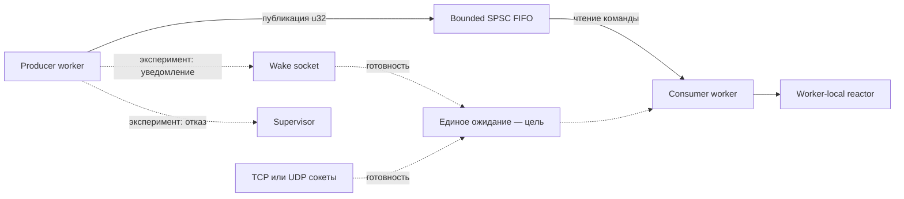
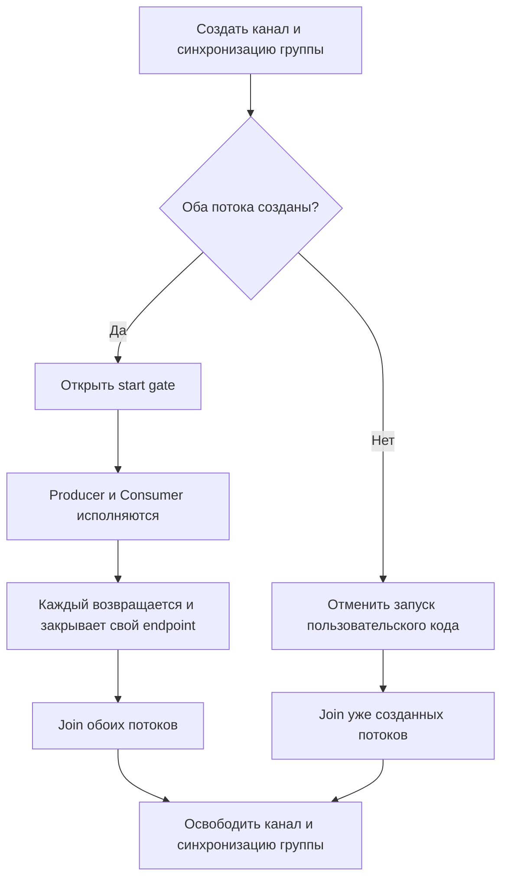
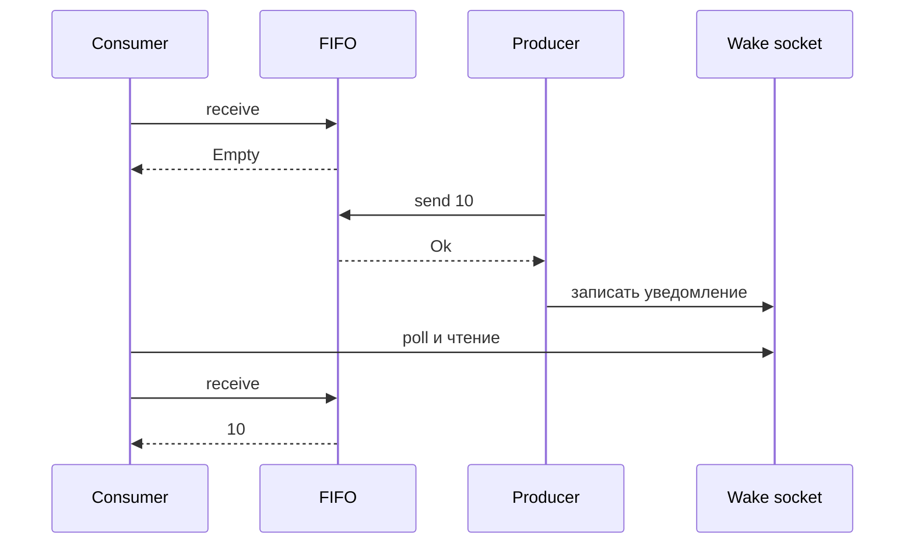
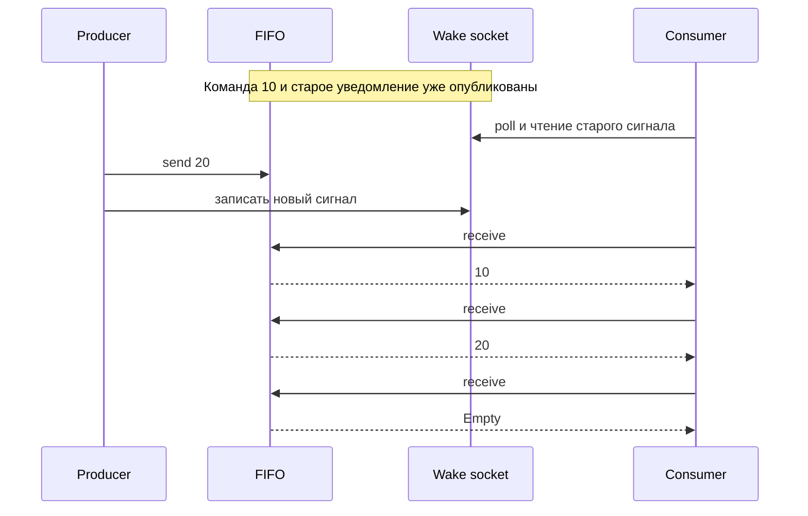
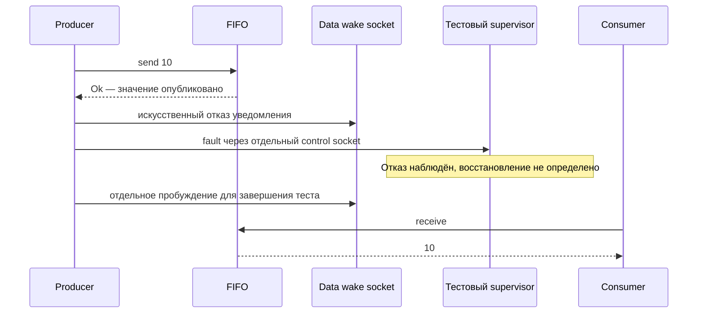
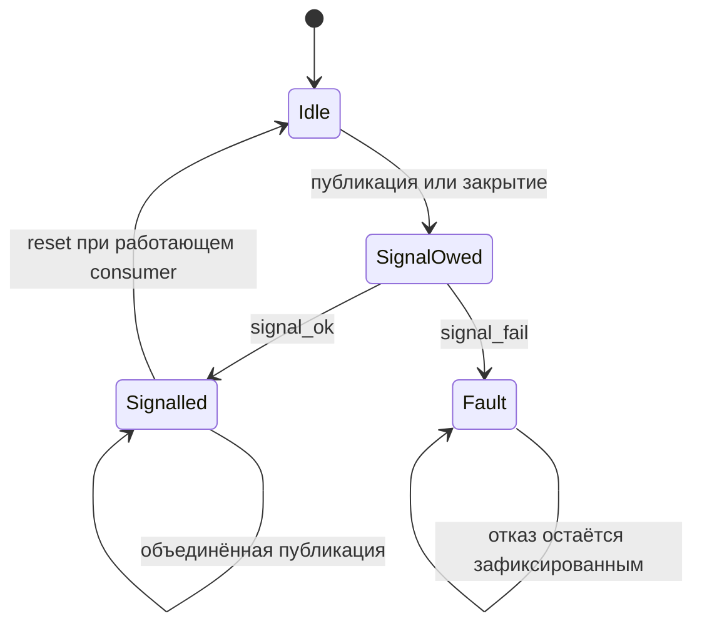

# Многопоточность и сеть: кто чем владеет

Эта страница разделяет **реализованные экспериментальные возможности Liza**,
**исследовательские C-стенды** и **целевую архитектуру**. Схемы уведомлений не
описывают существующий публичный API или гарантии production runtime.

## Общая картина

На схеме — направление развития сетевого сервиса. Сейчас Liza предоставляет
scoped workers, ограниченный SPSC-канал `u32` и worker-local reactor. Пример
[канала с TCP reactor](channel-reactor-example.md) использует их вместе, но
ожидает команды повторными попытками. Единое ожидание сети и канала, а также
supervisor на схеме пока исследуются отдельно в C.

FIFO хранит сообщения и остаётся источником истины. Wake socket лишь сообщает,
что очередь стоит проверить: его байты не являются командами, и число
уведомлений не обязано совпадать с числом сообщений. Потенциальное объединение
сигналов требует отдельного согласованного протокола.

Легенда общей схемы: **сплошные стрелки** показывают связи уже реализованных
экспериментальных механизмов Liza; **пунктирные** — исследовательские или целевые
связи. Это обозначение статуса реализации, а не порядка выполнения.

## Жизненный цикл scoped-группы

Схема относится к текущему `channels.run`: канал принадлежит runtime группы,
а не отдельному worker. Start gate не допускает пользовательский код, пока
не создана вся группа. При частичном запуске уже созданные потоки завершаются
без вызова пользовательских функций.

Endpoints могут закрываться в разное время: ранний возврат consumer запрещает
дальнейшие публикации и учитывает отброшенные сообщения. Память канала
освобождается после join всех созданных потоков. Локальными Region и Reactor
распоряжается сам worker: схема не обещает автоматического закрытия этих
ресурсов. Отказ до создания потоков освобождает уже приобретённые ресурсы;
trap и аварийная ошибка join не гарантируют штатный cleanup.

Wake sockets и supervisor пока относятся к C-экспериментам. Их будущий
жизненный цикл не следует из этой схемы `channels.run`.

## Публикация перед ожиданием

В [исследовательском probe PR #67](https://github.com/rulerom/liza/pull/67)
тестовая синхронизация останавливает consumer после проверки пустой очереди.
Producer публикует значение и отправляет уведомление до того, как consumer
продолжит и вызовет `poll`.

Тест подтверждает выбранную последовательность с реальным сокетом; он не
доказывает безопасность всех расписаний и не утверждает, что consumer уже спал.

## Сброс уведомления и новая публикация

Сброс старого сигнала не доказывает, что очередь пуста. В другом сценарии
consumer читает старый сигнал, producer публикует новую команду, а consumer
проверяет FIFO до следующего ожидания.

Отрицательный контроль стенда пропускает повторную проверку и обнаруживает
потенциально потерянное пробуждение. Для общего решения необходимо согласовать
проверку очереди, сброс и подготовку ко сну при всех допустимых расписаниях.

## Отказ после публикации

В стенде supervisor узнаёт об искусственном отказе, но восстановление не
выполняет: тест отдельно будит consumer для завершения. Сообщение уже
опубликовано, поэтому отказ wakeup нельзя представлять как обычный отказ
публикации. Наблюдение отказа само по себе не гарантирует его обработку.

## Абстрактная модель уведомления

Ограниченная [модель безопасности](https://github.com/rulerom/liza/tree/main/verification/notification_protocol)
исследует другие объекты, чем TCP-сокеты, и не доказывает их корректность.

`SignalOwed` означает незавершённую обязанность отправить сигнал, а не
подтверждённое пробуждение. `Signalled` не означает обработку сообщения.
Независимое наблюдение `Fault` в модели предполагается; в production его
механизм ещё не определён. Модель не доказывает прогресс планировщика или
своевременную доставку уведомлений.

## Что доступно сегодня

Жизненный цикл описан в [SG0: supervisor и жизненный цикл группы](sg0-lifecycle-contract.md).
Композиция с реальной UDP-сетью исследуется в [SG1: reactor worker](sg1-reactor-worker.md).
SG0 разделяет состояние worker и группы, snapshot и подтверждённый join;
его C-прототип проверяет выбранные сценарии и пока не интегрирован в API Liza.

| Компонент | Состояние |
| --- | --- |
| Scoped workers, локальные Region и Reactor | Экспериментальные возможности Liza |
| Scoped SPSC `u32`, отдельные результаты участников | Экспериментальный API Liza |
| Команды и локальный TCP reactor | Исполняемый пример с повторными попытками |
| Модель FIFO и историй, модель уведомлений | Ограниченные исследовательские проверки |
| Сокеты пробуждения и независимый тестовый supervisor | C-стенды, не API Liza |
| Согласованный notification protocol | Проверенный C-прототип SG0/SG1 |
| TCP + заимствованные wake sources в одном ожидании | Внутренний C-интерфейс production Reactor |
| Scoped-владение wake-ресурсами и бюджет группы | [Проект контракта SG2](sg2-scoped-runtime-ownership.md) |

Подробнее: [workers](scoped-workers.md), [scoped-канал](scoped-channels.md),
[модель и истории FIFO](scoped-channel-model.md),
[контракт ожидания](scoped-channel-wait-contract.md),
[платформенный probe](https://github.com/rulerom/liza/tree/main/experiments/reactor_wakeup)
и [исследование runtime-последовательностей](https://github.com/rulerom/liza/pull/67).
