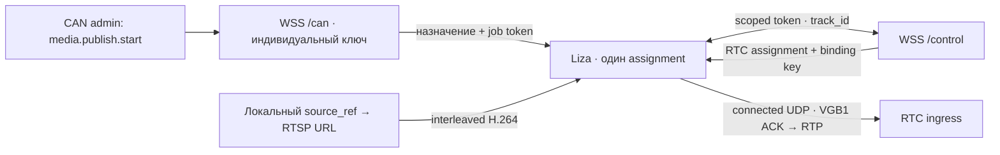

# CAN RTSP publisher

Экспериментальный `examples/apps/liza_rtsp_service.liza` реализует
[CAN RTP-service 0.2](https://videograce.ru/doc/developer/protocol/rtp-service/).
Для новых серверов VideoGrace это замена публикации RTP от обычного пользователя:
обычные клиенты используют WebRTC, а сервис получает scoped-разрешение через CAN.
Первая live-проверка нового пути завершена: 23 ноября 2026 года пользователь
подтвердил движущееся видео в браузере. Это не приёмка длительной эксплуатации;
результаты старого RTSP-клиента учитываются отдельно.



## Сборка и конфигурация

```sh
python3 -m liza build --project-root examples \
  examples/apps/liza_rtsp_service.liza -O 2 -o liza-rtsp-service
./liza-rtsp-service /private/path/service.json
```

Конфигурация и файл ключа должны быть доступны только владельцу. В argv
передаётся путь к конфигурации, сам ключ читается из отдельного файла.

```json
{
  "node_id": "office-bridge-01",
  "service_id": "office-camera-bridge",
  "source_ref": "camera-lobby",
  "camera_ip": "192.0.2.10",
  "camera_port": 554,
  "camera_url": "rtsp://192.0.2.10/stream1",
  "vg_ip": "192.0.2.20",
  "vg_peer": "vg.example.org",
  "service_token_file": "/private/path/service-token",
  "client_version": 619,
  "run_ms": 0,
  "rtp_pace_ms": 1
}
```

Адрес подключения числовой IPv4; `vg_peer` задаёт проверяемую TLS-идентичность.
По умолчанию используется системное доверие, `ca_file` явно задаёт другой CA.
`run_ms: 0` означает работу до остановки. Пустой или отсутствующий `source_ref`
включает только регистрацию и heartbeat, с пустым списком capabilities.
Конференция приходит из назначения, а не из локальной конфигурации.

## Задание администратора

```json
{
  "job_type": "media.publish.start",
  "target_service_id": "office-camera-bridge",
  "target_node_id": "office-bridge-01",
  "payload": {
    "conference_tag": "example-room",
    "source": {"kind": "rtsp", "source_ref": "camera-lobby"},
    "media_permissions": {
      "publish": [{
        "track_id": "lobby-video",
        "device_type": 1,
        "video_codec": 2,
        "max_bitrate_bps": 4000000
      }],
      "subscribe": []
    }
  }
}
```

Нужен активный сеанс конференции и соответствующая политика сервиса:
node, роль `worker`, три capabilities `rtsp.ingest`, `rtp.publish`, `video.h264`,
тип задания, конференция и publish grant для данного `source_ref`.
`max_bitrate_bps` обязателен при назначении: положительное целое, не больше
разрешённого политикой. Отсутствие подходящего grant оставляет задание в `pending`.
Поле задаёт разрешение; клиент пока не реализует адаптивный bitrate control камеры.
Сервисный ключ не предоставляет административного права постановки задания.

## Жизненный цикл и ограничения

Один CAN-сеанс, один RTSP-источник, один H.264 track и один активный assignment.
Проверяются `service_auth=1`, `rtp_service=1` и серверная идентичность сервиса;
перехода на старую пользовательскую RTP-публикацию нет.
Авторизация `/control` использует только job token. RTP отправляется после
подтверждения маршрута и VGB1 ACK; `running` не означает доставку зрителю.

Новый `rtp_assignment_id` требует нового connected UDP endpoint. Повтор того же
grant не меняет endpoint. При потере CAN старое назначение инвалидируется,
закрываются media/control/camera ресурсы; оно не переносится в новый CAN-сеанс.
Ошибка камеры запускает её восстановление внутри действующего назначения.
Отмена проверяется по паре `job_id` / `assignment_id` и прекращает публикацию.

UDP-медиа не шифруется этим протоколом: требования доверенного сегмента/VPN/ACL
задаются контрактом развёртывания VideoGrace. Это не SRTP/WebRTC клиент.
Новый worker пока запускается как CLI и не подключён к упаковке macOS-службы
старого пользовательского RTSP-клиента.

Локальные проверки: `test_rtp_service.py` (WSS, scoped control, VGB1, RTP,
heartbeat, отмена и graceful close на O0/O2) и `test_reactor_connected_udp.py`
(смена endpoint, фильтрация peer, сохранение TCP). Для WSS-проверки нужен
`LIZA_TEST_TLS=1` и OpenSSL 3.

## Первая live-проверка · 23 ноября 2026

На `demo.videograce.ru`, конференция `radio`, узел `liza-rtsp`, источник
`stream1`: назначение принято, scoped control авторизован, VGB1 ACK проверен,
пользователь подтвердил изображение. После восстановления питания камеры worker
подключился без перезапуска процесса внутри действующего назначения.
Перезапуск сервера прервал CAN: старое назначение было сброшено; публикация
возобновилась после нового задания администратора.

При диагностике чёрного изображения локальный захват на выходе содержал
1 758 RTP без пропусков sequence, два полных IDR, SPS/PPS (`640028`).
Из этой выборки офлайн декодированы 189 разных кадров без ошибок. FFmpeg
использовался только для независимой диагностики захвата, не в приложении.
Захват подтверждает корректность этой локальной выборки, а не отсутствие потерь
до RTC. Позднее пользователь подтвердил видео; причина начальной задержки
не установлена, гипотеза о H.264 profile mismatch не подтверждена.
Секреты, конфигурация стенда и PCAP не включаются в репозиторий.
