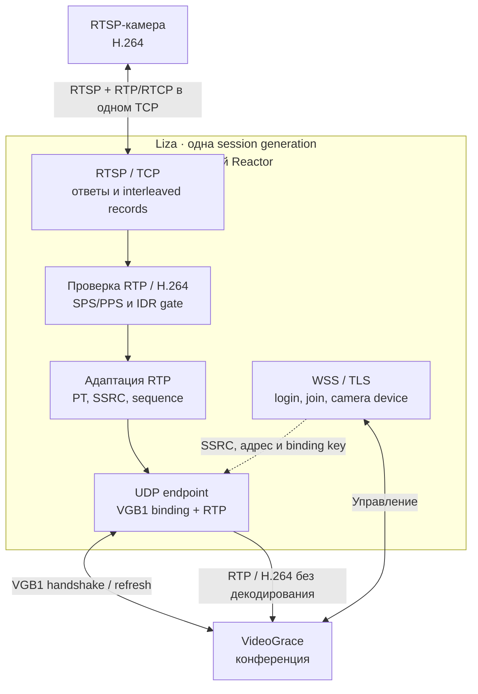
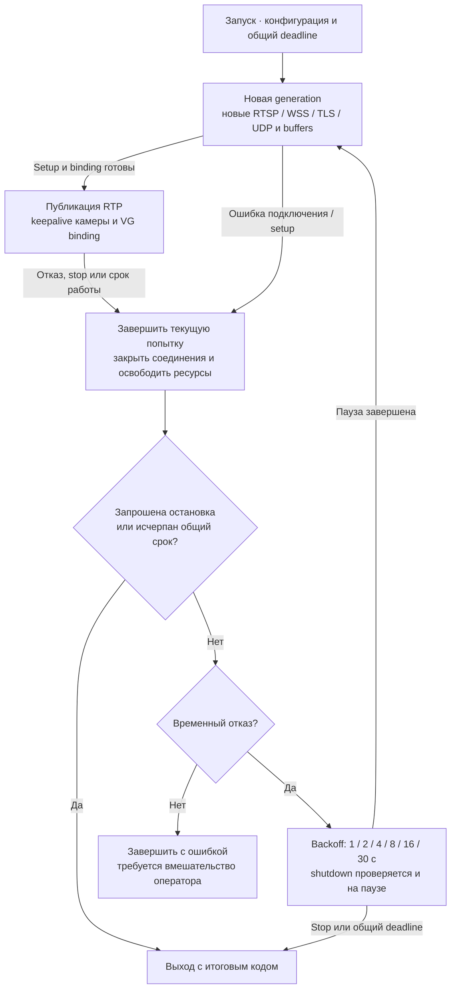

# RTSP → VideoGrace client

Отдельно: [длительный прогон и наблюдение до 24 часов](rtsp-endurance.md).
Установка службы: [macOS LaunchDaemon](rtsp-service-macos.md).

Экспериментальный CLI-клиент передаёт видео H.264 с RTSP-камеры в конференцию
VideoGrace. Вход на сервер выполняется как обычный пользователь через WSS,
без CAN. Протокольный код и медиатракт написаны на Liza; внешние ffmpeg,
Python и декодер не запускаются. OpenSSL обеспечивает TLS и HMAC-SHA256.



Сплошной медиатракт сохраняет сжатый H.264 payload: кадры не собираются и
не декодируются. WSS управляет публикацией, а UDP передаёт RTP после
подтверждения binding. Приём отправки операционной системой не подтверждает
доставку зрителю.

## Сборка и запуск

Нужны Clang и OpenSSL 3, как для [HTTPS/WSS](tls-transport.md).
На macOS при необходимости задайте `LIZA_OPENSSL_PREFIX` путём установки
OpenSSL, например `/opt/homebrew/opt/openssl@3`.

```sh
python3 -m liza build --project-root examples \
  examples/apps/liza_rtsp.liza -O 2 -o liza-rtsp
./liza-rtsp /private/path/rtsp.json
```

Рекомендуется `O2`. На `O0` фиксированные агрегаты создают крупные кадры
стека: в исследованном Windows x64 lowering около 3,05 МиБ у основного
цикла и 2,28 МиБ у вложенного WSS step. Сохраняется существующий TLS PE stack
reserve 8 МиБ; это отдельная величина от Region и `tls.managed_bytes()`.

Конфигурация — JSON до 4096 байт. Храните её с ограниченными правами: пароль
читается из файла, а не из argv. Реальные пароли и ответы с ключами не следует
сохранять в репозиторий.

```json
{
  "camera_ip": "192.0.2.20",
  "camera_port": 554,
  "camera_url": "rtsp://192.0.2.20/stream1",
  "vg_ip": "192.0.2.10",
  "vg_port": 443,
  "vg_peer": "demo.example.org",
  "login": "camera-user",
  "password": "replace-locally",
  "conference": "radio",
  "client_version": 617,
  "run_ms": 60000
}
```

`camera_ip` и `vg_ip` — числовые IPv4; DNS resolver не используется.
`camera_url` задаёт RTSP resource, а TCP подключается к `camera_ip:camera_port`.
`vg_peer` задаёт TLS identity/SNI и HTTP Host независимо от TCP IP.
`client_version` задаётся для выбранного сервера и читается при запуске;
после изменения файла работающий процесс нужно перезапустить. Например,
после обновления `demo.videograce.ru` 17 ноября потребовалось значение 618.
Отказ `connect_response.result=3` (`UpdateRequired`) является постоянным
для прежней конфигурации и не устраняется сетевым reconnect. Код приложения
20 также охватывает другие ошибки login-ответа; сам по себе он не указывает
точный `connect_response.result`.
Системное доверие обязательно; необязательный `ca_file` выбирает явный CA
для этой session. Переключения на небезопасный транспорт при TLS-ошибке нет.
`run_ms` — 100..3600000 мс; `0` отключает общий лимит времени работы.
При отсутствии поля сохраняется default 60000 мс. В режиме `0` клиент работает
до `Ctrl+C`/SIGTERM, остановки сервером либо ошибки камеры/соединения.
Таймауты подключения, I/O, отсутствия RTP и завершения остаются ограниченными;
временные сетевые отказы вызывают автоматический reconnect с backoff
1/2/4/8/16/30 секунд. Постоянные ошибки конфигурации, авторизации, TLS-проверки
или протокола завершают процесс и требуют вмешательства. Без аргумента или при неверной конфигурации код
выхода 2. Нормальное завершение — 0; ошибки транспорта/протокола — ненулевой код.

## Протокол и владение

Постоянные методы и заголовки записываются [байтовыми литералами](byte-literals.md),
например `b"PLAY"` и `b"Content-Length"`. Они передаются как readonly views;
модуль `rtsp.words` с десятичными ASCII-массивами больше не требуется.

Один Reactor владеет UDP endpoint и двумя исходящими TCP-соединениями:
RTSP камеры и WSS сервера. UDP endpoint исключает TCP listener, но не
исходящие TCP slots. Числовой socket handle приложению не выдаётся.
Отдельный supervisor Reactor владеет регистрацией shutdown-сигнала и служит
для ожидания между попытками. Его временный listener сразу закрывается;
постоянных сетевых сокетов и дополнительных потоков у supervisor нет.

RTSP выполняет `OPTIONS → DESCRIBE → SETUP → PLAY`, затем `GET_PARAMETER`
каждые 15 секунд. В первой версии используется RTP/RTCP interleaved TCP,
каналы 0/1; RTCP извлекается из framing и пропускается. Парсер сохраняет
частичные заголовки, body и `$` records, проверяет CSeq и границы размеров.
Остановка по сроку работы или SIGINT/SIGTERM отправляет `TEARDOWN` при живой
session, удаляет VG camera device, покидает конференцию и закрывает WSS/TLS.
Ожидание остановки ограничено 5 секундами, затем локальные ресурсы закрываются.
Это не гарантия получения последнего control-сообщения удалённой стороной.

Обычный VG control loop выполняет login, join, `device_params` и
`device_connect`. Device ID, SSRC, UDP port и binding key назначает сервер.
Объявленный сервером `0.0.0.0` или пустой RTP address означает IP текущего
WSS peer; числовой IPv4 используется явно. Другой hostname отвергается.
VGB1 Author handshake проверяет HMAC, SSRC, роли и nonce. Ключ — ровно
64 ASCII hex-байта, а не декодированные 32 байта. Без подтверждения handshake
за 5 секунд публикация завершается ошибкой. Binding обновляется каждые 5 секунд.

`net.reactor_udp_receive` возвращает тот же owned Buffer также при ошибке,
сохраняя его Region origin. Публичные UDP wrappers используют существующий
нативный endpoint. `hmac.sha256` принимает синхронные views, ключ 1..1024 байт
и сообщение до 4096 байт, возвращает 32 байта либо `HmacError`.
Эти лимиты не являются полным пределом внутренних allocations OpenSSL.

## H.264 и ограничения

Поддерживается один video track `H264/90000`, `packetization-mode=1`, SDP с
`sprop-parameter-sets`, `control` и `framesize`. Поддерживаются single NAL,
STAP-A и FU-A. Кадры не собираются и не декодируются. H.264 payload и RTP
timestamp/marker сохраняются; выходной PT — 102, SSRC назначен VG, sequence
ведётся локально, поскольку перед первым IDR вставляются SDP SPS/PPS.

До первого IDR пакеты отбрасываются. Разрыв sequence или некорректная
пакетизация закрывают gate до следующего IDR и повторной отправки SPS/PPS.
Уже отправленные части повреждённого access unit отозвать невозможно:
это не атомарная доставка кадров и не гарантия декодирования после потери.

Пределы: WS message 64 КиБ, исходящий WS payload 4 КиБ, RTSP header/body
фиксированы, interleaved record до 4096 байт, SPS/PPS до 256 байт каждый.
Входящие большие WS сообщения не расширяют CAN-профиль с его лимитом 4 КиБ.
Нет RTSP authentication, аудио, UDP-транспорта со стороны камеры, DNS,
обработки смены SPS/PPS/разрешения внутри сессии и CAN lifecycle.
Камера должна поддерживать указанный профиль и keepalive.

## Reconnect



После временного отказа приложение полностью закрывает текущую пару
RTSP/WSS, UDP endpoint, TLS session и Region/Buffer, затем заново выполняет
RTSP setup и VG login/join/device registration/media binding. Динамические
ID, CSeq, SSRC, nonce, ключ, parser и IDR gate из старой попытки не переносятся.
В одной попытке нет доступа к ресурсам другой; межгрупповых очередей нет.

Повторяются connection/transport loss, timeout RTSP-ответа (код 32),
отсутствие RTP (33), startup deadline VG (31) и временные ошибки WSS.
WS close 1000/1001, отсутствие кода и server failure/restart 1011..1014
без предварительной команды остановки также запускают reconnect.
Protocol/policy close (например, 1002/1008) и неизвестные application-коды
завершают процесс; ответ на close после уже принятого stop не запускает retry.
Backoff: 1, 2, 4, 8, 16, затем максимум 30 секунд; после сессии не короче
30 секунд с успешными UDP sends следующая пауза снова составляет 1 секунду.
При `run_ms: 0` число временных попыток не ограничено, частота ограничена
backoff. На паузе shutdown проверяется с шагом не более 50 мс, без busy loop.

Ошибки конфигурации, авторизации, сертификата/имени, malformed RTSP/WS,
неверный CSeq и исчерпание известных ресурсных лимитов не повторяются.
TCP EOF без завершённого WS close считается потерей транспорта, а не успешным
завершением сообщения: недополученные данные отбрасываются вместе с сессией.
TLS verification и ошибки TLS records не превращаются в insecure fallback.

`run_ms` остаётся общим временем процесса, включая попытки и backoff;
на reconnect срок не начинается заново. Если он истёк во время паузы,
возвращается последняя ошибка. Общий shutdown остаётся bounded и может
добавить до пяти секунд к сроку работы. SIGINT/SIGTERM и штатная команда
удалённой остановки прекращают reconnect, также при timeout `TEARDOWN`.
Принудительная остановка процесса не восстанавливается самим приложением.

### Остановка модератором

Полученный от сервера `member_action` с `action: 9` (DisconnectFromConference)
и отсутствующим либо нулевым `result` означает явное исключение этого
подключения. Сервер сам выбирает целевую сессию; пересланная команда может
содержать пустой `id: []`. Клиент прекращает публикацию, выполняет bounded
cleanup и завершает процесс, не выполняя reconnect или повторный join.
Ненулевой `result` — ответ на действие, а не новая команда исключения.

Также завершают клиент команды `disconnect`, `disconnect_from_conference`
и `device_disconnect` для его собственного устройства. В VG decoder есть
узкое исключение совместимости для точных legacy-форм `{"disconnect"}` и
`{"disconnect_from_conference"}`, которые сериализует C++-референс; пробелы
вокруг разделителей допустимы. Это не JSON общего назначения: `json.*`
сохраняет строгую проверку, а другие повреждённые сообщения отвергаются.

Причина выводится явно, например:

```text
VideoGrace moderator requested disconnect from conference (member_action action=9); stopping connector without reconnect
```

Другие moderator actions пока не реализуют интерактивные функции полного
VideoGrace-клиента: они отмечаются в логе как неподдерживаемые. Уведомление об
удалении чужого устройства не останавливает собственную камеру. Один лишь
TCP EOF или WS close 1000 не позволяет определить намерение модератора и
по-прежнему обрабатывается согласно сетевой retry policy; сервер должен
передать явную команду остановки до закрытия соединения.

При успешном cleanup код выхода 0 не запускает немедленный рестарт через
`KeepAlive.SuccessfulExit=false` в профиле службы macOS. Ошибка cleanup может
дать ненулевой код, но также не запускает внутренний reconnect после принятой
команды остановки. Последующий явный запуск оператора — новый жизненный цикл.

Лог `RTSP session generation=N` обозначает новую локальную попытку;
`uptime_ms` в этой строке и записи retry отсчитывается от начала supervisor.
Счётчики `RTP received/attempted/succeeded/gated/discontinuities` выводятся
для каждой завершённой сессии отдельно. `RTSP reconnect after error ...
delay_ms=...` сообщает о повторе. Timeout дополнительно показывает CSeq
и фазу: 6 — `GET_PARAMETER`, 7 — `TEARDOWN`. `RTSP connector finished
code=...` означает завершение всего процесса. Это приложение на Liza;
compiler и production runtime для reconnect не менялись.

## Приёмка

### Запрос ключевого кадра

Коннектор обрабатывает нативный VG `RTCP APP amtForceKeyFrame` (20 байт,
APP name = 1) только от текущего адреса/порта RTP Translator при активном
binding. SSRC этого сообщения принадлежит **получателю**; его нельзя
использовать как SSRC камеры или сравнивать с SSRC публикуемого потока.
Другие APP-сообщения, неверная длина/заголовок и другой источник игнорируются.

Для камеры ставится в очередь compound RTCP `RR + SDES(CNAME) + PLI`,
обёрнутый в `$`-record канала 1 существующего RTSP/TCP-соединения. Media SSRC
берётся из проверенного входного RTP камеры, а не из адаптированного VG RTP.
Без известного SSRC запрос ожидает первый корректный пакет. Частичные TCP
writes и `WouldBlock` обслуживает та же очередь, что и RTSP-команды;
незавершённая запись не перезаписывается. Keepalive и остановка имеют приоритет. При остановке ожидающий запрос и
FIR fallback отменяются.

Повторные запросы объединяются; интервал между RTCP-запросами не меньше
одной секунды. Если после PLI не наблюдался IDR, допускается один FIR через
секунду. Через три секунды без IDR ожидание прекращается с диагностикой;
бесконечных повторов нет. Новая сессия не наследует запросы старой, а смена
SSRC камеры отменяет старое ожидание и переадресует ещё нужный запрос.
Перед IDR, наблюдаемым во время ожидания, повторно отправляются SPS/PPS из
SDP с тем же timestamp: новый получатель получает параметры декодера.

`Camera keyframe PLI/FIR queued` означает постановку TCP-записи в очередь,
не подтверждение камерой. `Camera IDR observed after keyframe request`
означает только последующее наблюдение IDR start: это мог быть и очередной
периодический кадр. `Keyframe feedback` раз в пять секунд показывает число
VG-запросов, объединений, PLI/FIR, наблюдений IDR и timeout.

Форматы соответствуют [PLI, RFC 4585](https://www.rfc-editor.org/rfc/rfc4585.html#section-6.3.1)
и [FIR, RFC 5104](https://www.rfc-editor.org/rfc/rfc5104.html#section-4.3.1).
Поддержка feedback камерой обязательна для фактического ускорения IDR.
Текущий профиль `RTP/AVP` не добавляет согласование `RTP/AVPF`/`a=rtcp-fb`:
для legacy-камеры это ограниченная best-effort попытка.

На исследованной камере с LIVE555 2014.03.25 запросы PLI, FIR и их сочетание
не ускорили периодический IDR (примерно каждые шесть секунд). Независимая
ONVIF-проверка `SetSynchronizationPoint` для профиля, указывающего на `stream1`,
также не ускорила IDR. ONVIF-клиент в приложение не добавлен. Этот результат
не является успешной приёмкой принудительного IDR для данной камеры;
он проверяет отсутствие ложного подтверждения и ограниченное поведение
при игнорировании запроса. Keyframe feedback не исправляет потери UDP.

### Диагностика

Ошибки выводятся в stderr понятным текстом с числовым кодом рядом.
Например, ответ `UpdateRequired` теперь даёт:

```text
VideoGrace login rejected: client version is too old (UpdateRequired); update client_version in config and restart (result=3, client_version=617)
RTSP/VG session stopped: VideoGrace login failed; see login details above (code=20)
```

Неверные credentials, ban, отсутствующий account, redirect и перегруженный
сервер имеют отдельные описания с реальным `connect_response.result`.
Ошибка join различает отсутствие конференции, запрет доступа, license capacity
и time limit. Названия соответствуют VideoGrace `CONNECT_RESPONSE::Result`
и `CONNECT_TO_CONFERENCE_RESPONSE::Result`; неизвестный result остаётся
явно неизвестным, с исходным номером.

RTSP timeout называет метод (`OPTIONS`, `DESCRIBE`, `SETUP`, `PLAY`,
`GET_PARAMETER` или `TEARDOWN`), 5000-миллисекундное ожидание и CSeq.
Неожиданный ответ показывает status, полученный и ожидаемый CSeq.
TLS сообщает об ошибке сертификата/peer identity, конфигурации, памяти,
deadline или протокола; сохраняются verify code и backend reason, если доступны.
Числовые коды ошибок, `generation`, `delay_ms` и `uptime_ms` не исчезают.

Сообщения используют статические [байтовые литералы](byte-literals.md),
не создают `can.text.Value`/String/Region ради текста ошибки. Credentials,
access tokens, binding keys и сырые JSON/RTSP сообщения не печатаются.
Нормальная обработка медиабайтов не получает побайтового логирования.

Коннектор пишет `RTP quality` каждые пять секунд и при завершении сессии:
число принятых, отклонённых и задержанных IDR-gate пакетов, sequence events,
ошибки отправки, смены SSRC, скачки RTP clock, паузы и возраст последнего
наблюдённого IDR start. Счётчики сбрасываются с новой сетевой сессией.
Принятая ОС отправка по-прежнему не подтверждает доставку зрителю.

Строки `RTP anomaly` содержат текущие и предыдущие SSRC, sequence и timestamp,
а также интервалы обработки пакетов/кадров. `RTSP anomaly: loop_pause`
показывает задержку между итерациями цикла. Пауза отмечается после 250 мс;
это время обработки в приложении, **не точное время прихода в ядро**.
RTP clock для H.264 считается с частотой 90 кГц: скачок более секунды,
не объясняемый прошедшим временем, отмечается отдельно. Естественное
переполнение timestamp/sequence и небольшие обратные presentation steps
не считаются clock jump. Это диагностическая эвристика, не валидатор
корректности камеры или доказательство причины зависания зрителя.

Подробные события ограничены одной строкой в секунду для clock/source
изменений и одной для остальных аномалий; подавленные события продолжают
учитываться в счётчиках. Нормальный поток не создаёт лога на каждый пакет.
Payload, пароли и ключи не выводятся. Формат `LIZA_RTSP_HEALTH`, используемый
service launcher, не изменён. Диагностика не переписывает RTP timestamps,
не сбрасывает соединение и не меняет IDR-gate.


### Проверки

Независимый локальный стенд проверяет O0/O2: RTSP fragmentation/CSeq,
обычный WSS login/join, фрагментированный control message больше 32 КиБ,
VGB1 с Python HMAC oracle, точный RTP payload, SPS/PPS, PT/SSRC/sequence,
а также `TEARDOWN`, удаление устройства и WSS/TLS close. Дополнительные
тесты проверяют RFC 4231, изменение MAC, SDP/Base64, IDR recovery,
truncation, нулевой datagram и сохранение Buffer.
Обрывы камеры, WSS EOF/RST и пропущенный keepalive проверяются с повторным
handshake, новым SSRC/ключом/nonce и восстановлением IDR gate. Есть три
последовательные сессии в одном процессе, общий deadline, SIGTERM в backoff,
отказ login/TLS identity без retry и удалённая остановка при timeout TEARDOWN.
Если восстановления до конца общего бюджета нет, процесс возвращает ошибку.

```sh
LIZA_TEST_TLS=1 python3 -m unittest discover -s tests -p 'test_rtsp*.py' -v
```

Live-приёмка 16 ноября 2026: H.264 High 4.0, 1920×1080, 25 fps с камеры
по RTSP/TCP опубликован в `radio` на `demo.videograce.ru`. Пользователь
подтвердил движущееся видео в веб-клиенте. Минутный прогон завершился кодом 0:
12 329 пакетов обработано bridge, 1 075 отброшено до IDR, 11 256 отправок
приняты ОС (включая два SPS/PPS), sequence discontinuities — 0.
Счётчик успешных send не измеряет полную доставку и не является benchmark.

Повторный пятиминутный прогон тем же O2-бинарником завершился кодом 0:
60 726 bridge inputs, 1 050 gated, 59 678 отправок приняты ОС (включая
два SPS/PPS), sequence discontinuities — 0. Зритель вышел из конференции
и подключился снова посреди потока; движущееся видео подтверждено пользователем.
`time -l`: 300,27 с wall, 205,95 с user, 3,39 с system, maximum RSS
15 581 184 байт (14,9 МиБ). Это диагностика всего процесса, а не измерение
изолированного hot path или предела производительности.
SHA-256 бинарника:
`221770e493da92261f52d2d1d91196bd932dc479b8c551cde544f4ed77d40b99`.

## Устранение копий parser

В отдельном эксперименте `rtsp.tcp.step` перешёл на
`borrow mut state.parser`, а RTSP header/body обновляются через заём поля.
Крупный `Event` больше не переносится через обратное ребро побайтового цикла.
Снимки готового пакета/ответа и холодного завершённого RTSP header сохраняются.
RTP bridge, H.264, VG signaling и системный Reactor не менялись.

Три чередующиеся пары по 60 секунд на той же камере, Apple M4, O2:

| Медиана | Baseline #99 | Заём поля |
| --- | ---: | ---: |
| CPU, доля одного ядра | 0,728 | 0,238 |
| CPU на наблюдавшийся входной пакет | 3497,9 мкс | 1152,0 мкс |
| Наблюдавшиеся входные RTP/с | 208,17 | 207,89 |
| Максимальный RSS | 14,94 МиБ | 14,86 МиБ |

CPU на наблюдавшийся пакет уменьшился примерно в 3 раза; PPS и RSS практически
сохранились. Это CPU всего процесса, включая startup, IDR gating и завершение,
а не изолированное время обработки пакета. Камера не является генератором
контролируемой нагрузки; предел throughput и latency не измерялись.
Все шесть прогонов завершились штатно, без sequence discontinuities.

Доли `memmove` в отдельном CPU sample: 77,1% → 28,0% main-thread samples;
`poll`: 21,8% → 69,0%. Основные оставшиеся копии относятся к WSS/владельческим
состояниям. Это не утверждение о полном zero-copy или точной доле CPU.
Сырые показатели, SHA-256 исходников/бинарников и повторяемый запуск сохранены
в `benchmarks/rtsp-parser/`. Больших копий в payload-byte helper и записи Wire
нет в проверенном LLVM IR и машинном коде O0/O2. Исключительность по-прежнему
охватывает весь корень; ресурсные mutable borrows не добавлены.
