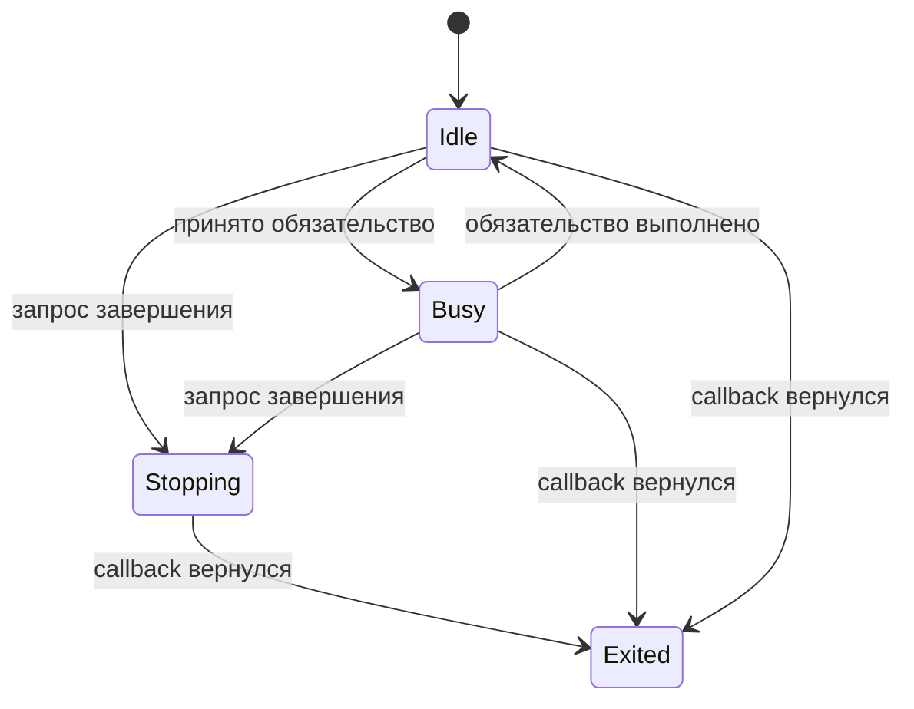
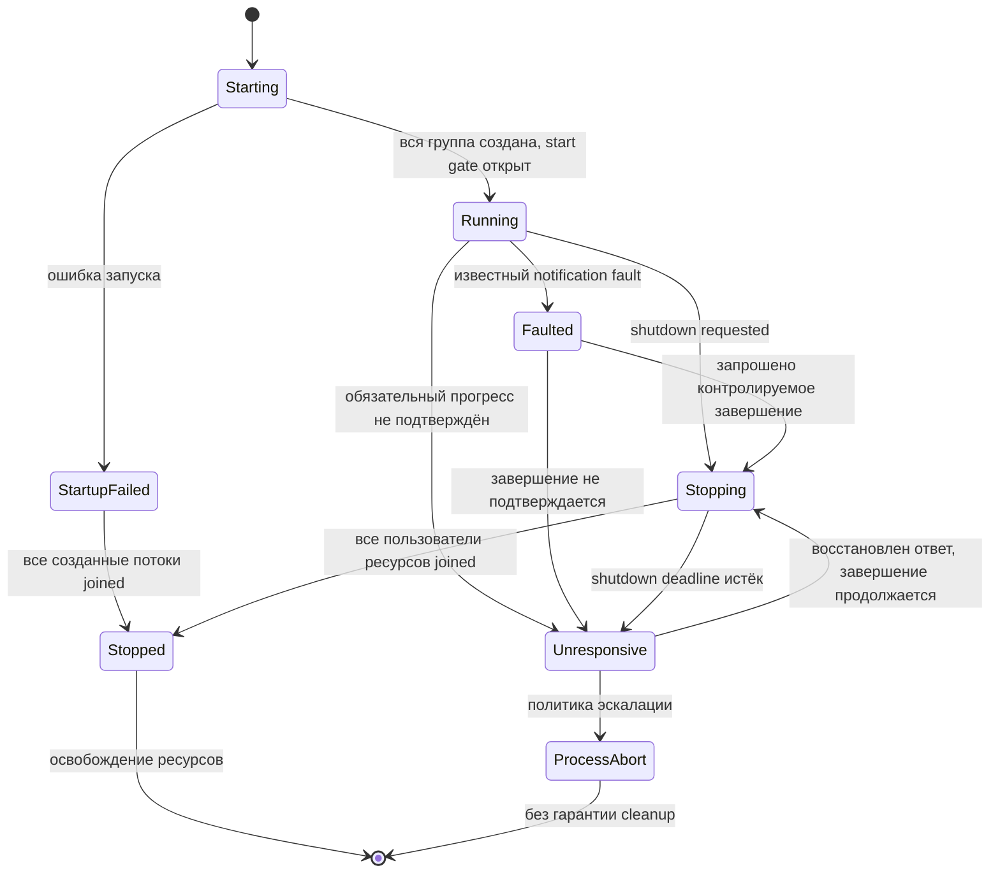

# SG0: Supervisor и жизненный цикл группы

**Статус: контракт исследовательского C-прототипа, не возможность API Liza.**
Он продолжает [архитектуру concurrency](concurrency-architecture.md) и
[проверку границ notification protocol](https://github.com/rulerom/liza/tree/main/verification/notification_runtime).
API языка, Semantic IR и production runtime этим документом не изменяются.

[Прототип SG0 и его тесты](https://github.com/rulerom/liza/tree/main/experiments/sg0)
проверяют выбранные сценарии этого контракта. В нём используется отдельный
join-service с памятью на время жизни процесса, один in-flight command и
управляемые тестовые gates. Это ещё не переиспользуемый runtime групп;
ограничения, бюджеты и доверенная часть журнала перечислены в README прототипа.

Главный принцип: владение ресурсом заканчивается после подтверждённого
завершения его пользователей, а не после прекращения ожидания их ответа.

## Два автомата

Состояние worker описывает обязательство исполнения. Состояние группы
описывает решение о запуске, завершении или эскалации. Это разные данные.

`Idle` допускает ожидание готовности без обязательной работы. `Busy` содержит
идентификатор обязательства и абсолютный deadline. Счётчик прогресса обновляется
при содержательном завершении части работы, а не на каждой итерации цикла.
Он **не продлевает deadline**. Новое обязательство и новый срок публикуются
отдельным переходом. `Stopping` подчиняется общему deadline shutdown.

`Exited` публикует runtime-обвязка **после возврата callback**. Это не означает,
что завершён сам нативный поток: обвязка ещё может обращаться к данным группы.
Только group owner выставляет `joined[i]` после успешного системного join.

Восстановление ответа не отменяет запрос shutdown. Истечение срока не
доказывает deadlock. `ProcessAbort` — отдельный исход процесса, а не `Stopped`.
Причина первоначального отказа сохраняется при переходе `Faulted → Stopping`.

## Кто наблюдает кого

Supervisor наблюдает workers, group owner наблюдает supervisor. Третьего
наблюдателя внутри группы нет. Возможность выполнения owner и доступность
монотонных часов — явные предположения. Остановка всего процесса или owner
не обнаруживается этим внутренним протоколом.

Наблюдение не захватывает protocol mutex. Известный отказ публикуется в
отдельном атомарном `fault_code`; первый ненулевой код сохраняется. Если поток
остановился до публикации кода, supervisor может узнать лишь об отсутствии
подтверждённого прогресса, но не причину. Ошибка notification и недоступность
механизма наблюдения не подменяют друг друга.

Законный `Idle` не становится `Unresponsive` из-за отсутствия новых сообщений.
Однако опубликованная команда создаёт обязательство доставки/принятия:
устаревший `Idle` consumer не должен скрывать застрявшую команду. Прототип обязан
явно учитывать это обязательство у отправителя или owner до подтверждения
принятия. Одного worker heartbeat недостаточно.

## Согласованный snapshot

Базовый вариант для исследования: один writer на status record, атомарные
`version`, `state`, `obligation_id`, `deadline` и `progress_epoch`. Для первого
прототипа все операции над этими полями используют `memory_order_seq_cst`;
ослабление порядков памяти требует отдельного обоснования и проверок.

Writer переводит версию в нечётную, обновляет поля и завершает публикацию новой
чётной версией. Reader принимает запись, только если версии до и после чтения
совпали и чётны. Обычные конкурентно читаемые неатомарные поля запрещены.
Переполнение version/epoch не должно приводить к повторному использованию
значения: до исчерпания диапазона фиксируется ошибка и запрашивается завершение.

Reader делает **ограниченное число попыток**. Если writer остановился на
нечётной версии, результат — `SnapshotUnavailable`, а не бесконечный retry и
не выдуманный `Busy` со смешанным deadline. Owner сохраняет последнее принятое
обязательство; длительная недоступность snapshot оценивается отдельным сроком
наблюдения. Истечение этого срока означает `Unresponsive`, но не доказывает
зависание worker. Длительность и число попыток задаются конфигурацией теста.

Каждое принятое сочетание полей должно соответствовать одной завершённой
публикации. Тест принудительно прерывает writer между изменениями полей и
проверяет отказ reader от смешанного снимка. Отрицательная мутация отключает
проверку версий: она должна воспроизвести конкретную ложную классификацию,
а не просто увеличить число retries.

## Shutdown и освобождение

Запрос shutdown публикуется отдельно от status record worker. Он запрещает
приём новых обязательств и устанавливает один абсолютный срок завершения;
повторные запросы не отодвигают его. Точка прекращения публикаций должна быть
согласована с notification protocol. Уже опубликованные сообщения досылаются
или явно учитываются как discarded по выбранной политике прототипа.

Group owner ведёт множество **фактически созданных** участников и результаты
их join, включая supervisor, если он обращается к ресурсам группы:

`ReleaseAllowed ⇒ для каждого созданного пользователя ресурсов joined[i]`.

Start gate не открывается при частичном запуске; созданные потоки завершаются
без пользовательских callbacks. Освобождение допускается после их join.
Ошибка join и сообщение `Exited` не дают права выставить `joined[i]`.

Owner не должен терять возможность применить shutdown deadline, заблокировавшись
на безусловном join потенциально живого потока. Прототип обязан выбрать и
документировать платформенный механизм ожидания завершения/эскалации. Флаг
`Exited` сам по себе не делает последующий системный join ограниченным по времени.

При недоступном supervisor owner выбирает контролируемое завершение, если оно
возможно, либо `ProcessAbort`. Принудительное уничтожение отдельного worker с
последующим освобождением его памяти запрещено. После `Unresponsive` ресурсы
сохраняются, пока join не подтверждён, либо завершается весь процесс без обещания
штатных деструкторов.

## Приёмка C-прототипа

| Сценарий | Обязательная проверка |
| --- | --- |
| Законный Idle | Отсутствие активности не вызывает Unresponsive |
| Busy с deadline | Epoch не продлевает срок автоматически |
| Snapshot во время записи | Нет принятого смешанного состояния; retry ограничен |
| Worker удерживает protocol mutex | Supervisor и owner продолжают наблюдение без этого mutex |
| Notification fault после публикации | Значение сохранено, известный fault наблюдаем, новые публикации отклонены |
| Shutdown при публикации | Определённый порядок принятия обязательств и прекращения публикаций |
| Supervisor остановлен gate | Owner обнаруживает отсутствие требуемого ответа по отдельному правилу |
| Ошибка создания участника | Start gate закрыт; join всех созданных участников |
| Истёк shutdown deadline | Нет Stopped и нет вызова деструкторов живых ресурсов |
| Gate затем отпущен | Callback return, worker join, supervisor join, затем destroy |
| ProcessAbort | Отдельный дочерний процесс; отсутствие обещания cleanup |

Центральный тест удерживает worker живым за gate после срока. Проверяются
`Stopped == false` и `free_count == 0`. После отпускания gate журнал должен
подтвердить `worker_exit → worker_join → supervisor_join → resource_destroy`.
Если есть другие пользователи, их join тоже предшествует destroy.

Журнал фиксированного размера выделяется до запуска. События содержат
монотонные номера; переполнение журнала делает тест неприемлемым, а не молча
теряет события. Форматирование и вывод выполняются после завершения потоков.
Запись события не заменяет системный join. Отрицательные контроли должны
обнаруживать преждевременный destroy, ложный Stopped и смешанный snapshot.

Прогоны — Linux/macOS/Windows, управляемые gates, fault injection и отдельные
тестовые процессы с внешним timeout. Измеренные сроки не являются hard real-time
гарантиями; результат относится к проверенным сценариям, не ко всем расписаниям.

## Вне SG0

Интеграция с Liza API и настоящим сетевым reactor, восстановление после trap,
миграция workers, автоматический restart, универсальные сообщения и изменение
borrow-модели остаются вне этого этапа. SG0 не доказывает способность безопасно
завершать произвольно зависшие потоки.
