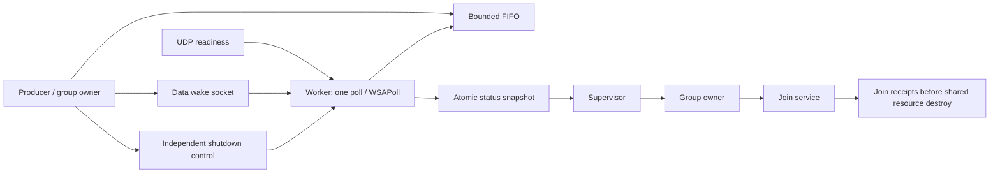

# SG1: reactor worker integration

SG1 — ограниченный C-прототип композиции notification protocol и lifecycle SG0
с реальной UDP-сетью. Язык и production runtime не меняются. Reactor здесь —
экспериментальный цикл `poll/WSAPoll`, а не вызов production Reactor Liza.

Worker создаёт, обслуживает и закрывает собственный UDP-сокет. Перед каждым
ожиданием он выполняет согласованную проверку FIFO и `arm`, включая возврат после
сетевого события. Timeout системного ожидания равен `-1`: периодической проверки
shutdown в сетевом worker нет. Shutdown приходит по отдельному control socket.

При отказе data notification опубликованная команда сохраняется. Supervisor
наблюдает атомарный fault без protocol mutex, owner запрашивает остановку через
независимый control source. Если прогресс не подтверждён, `Unresponsive` запрещает
освобождение общих ресурсов. Worker закрывает собственный сетевой сокет до
возврата; FIFO и wake/control sockets уничтожаются после join всех их пользователей.

## Проверка

Четырнадцать сценариев сохраняют проверки SG0 и добавляют сетевую готовность и
одновременно опубликованные команду и UDP-датаграмму. Gates задают выбранные
расписания. Три отрицательные мутации проверяют потерю shutdown wake, пропуск
повторной проверки FIFO и преждевременное разрешение destroy.

В idle-сценарии после входа в первый wait наблюдается не менее 750 мс простоя:
один вызов `poll`, ноль возвратов до shutdown, один возврат после control wake.
Выводятся wall-clock, CPU worker и CPU процесса. CPU — измерение, а не
универсальный порог приёмки. Supervisor и owner сохраняют периодическое наблюдение
SG0; отсутствие периодического опроса относится именно к сетевому worker.

Журнал подтверждает порядок закрытия сети, возврата worker, системных join и
уничтожения общих ресурсов. Timeout не заменяет join. `ProcessAbort` остаётся
отдельным исходом без обещания cleanup.

## Границы

Одна команда in-flight, одна UDP-датаграмма, bounded FIFO, фиксированный журнал и
join-service с памятью на время жизни процесса. Стеки, socket buffers, журнал и
join-service не входят в 1024-байтовый бюджет FIFO. Проверяются выбранные исполнения
на Linux/macOS/Windows; полного доказательства всех расписаний здесь нет.

Исходники и команды запуска: `experiments/sg1/README.md`.
Предыдущий контракт: [SG0](sg0-lifecycle-contract.md).
