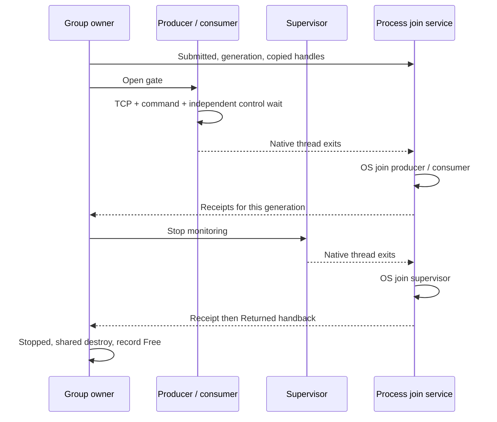

# SG2: внутренний runtime runner

**Описание исходного SG2-среза.** Его single-active-group restriction снято
в [B1](sg4-b1-multiple-groups.md), языковой интерфейс реализован в SG3.
Текущий пользовательский вход — [scoped-группы](scoped-groups.md).
Ниже сохранены исходная композиция и приёмка первого runner.

Первый внутренний C-runner реализует ограниченную композицию из
[контракта SG2](sg2-scoped-runtime-ownership.md). Код находится в
`liza/runtime/sg2.h`, `sg2_common.h` и платформенных translation units.
Он подключается явно при C-linking; существующий `channels.run`, язык и Semantic
IR не изменены. Это ещё не Liza-facing API.

## Выполнение

`liza_sg2_run(config, producer, consumer, report)` допускает одну активную группу
на процесс. Конкурентный или вложенный вызов возвращает `SG2_BUSY`, не создавая
новых участников. Создаются producer, consumer и supervisor. До полного startup
их callbacks закрыты gate; при ошибке созданные wrappers выходят без callbacks.

Группа владеет bounded FIFO `u32`, protocol mutex и двумя TCP wake pairs. Одновременно
принимается только одна необработанная команда. `liza_sg2_send` различает
`NOT_PUBLISHED`, `PUBLISHED`, `PUBLISHED_FAULT`; для повторной попытки после
`NOT_PUBLISHED` вызывающий код должен учитывать stop/fault. Универсального
блокирующего producer API здесь нет.

Consumer вызывает `take_or_arm` перед каждым wait, включая возврат из сетевого
обработчика. Он получает два заимствованных source handles и передаёт их
настоящему `liza_rt_reactor_poll_sources`. Data token сбрасывает протокол,
control token — consumer через `control_drain`. Сам Reactor не закрывает sources.

`liza_sg2_reactor_create` регистрирует один worker-local Reactor с capacity из
конфигурации. Consumer использует его обычные TCP-операции, но не закрывает его
самостоятельно: wrapper закрывает зарегистрированный Reactor после callback и
до `Exited`. Это предотвращает перенос cleanup сетевого владельца в group owner.
C-callbacks считаются доверенными: язык пока не проверяет их соблюдение этой роли.

## Join и reuse

На процесс создаётся один detached join-service с фиксированной записью. Он
спит на condition variable и не создаётся заново для каждой группы. Owner
передаёт native handles один раз через `Submitted` с release; service читает их
через acquire, копирует на свой стек и выполняет настоящие join. Каждый receipt
адресован generation и индексу участника. Owner после submit не выполняет join.

Receipts producer/consumer позволяют owner запросить остановку supervisor.
Финальный `Returned` публикуется после всех joins как последняя запись service
в содержимое запроса. Только после handback owner уничтожает группу и переводит
запись в `Free`. Service затем использует только mailbox для ожидания нового
запроса. Generation не оборачивается. Параметр service stack фиксируется первым
успешным созданием и не меняется между группами.

Owner использует ограниченный по deadline try-lock при submit, не бесконечное
ожидание service mutex. Protocol mutex не нужен ни owner для shutdown, ни
supervisor для наблюдения. Process service хранит только handles/receipts и
собственную синхронизацию, без указателя на group context.

## Наблюдение и отказ

Статусы имеют single-writer версию и атомарные state/deadline поля; чтение ограничено
восемью попытками. `take_or_arm` переводит consumer в Idle только после проверки
пустоты. Отдельный delivery deadline сохраняет обязательство принятой команды.
`liza_sg2_busy` — явное начало нового ограниченного обязательства, не heartbeat
и не автоматическое продление старого срока.

`operation_ms` ограничивает конкретное обязательство участника или доставки.
У нормальной группы нет общего ограничения длительности: она может работать
дольше `shutdown_ms`, пока выполняет свои обязательства. `shutdown_ms` задаёт
один абсолютный срок при переходе в Stopping; повторное наблюдение fault или
запрос остановки этот срок не продлевает. До Stopping shutdown deadline отсутствует.
При частичном startup отдельный срок того же размера ограничивает ожидание
завершения уже созданных wrappers; callbacks при этом не запускаются.

Owner наблюдает supervisor, supervisor — участников. Их интервалы наблюдения
составляют 1 мс; это не отсутствие polling у всего процесса и не real-time bound.
Сетевой consumer может ждать с `timeout=-1`, без periodic timeout. Участник может
попросить shutdown через atomic stop intent; только owner записывает control wake.

Data fault остаётся sticky и запрещает новые публикации. При control failure
отдельно сохраняется флаг `control_fault`, чтобы не потерять второй отказ за
первым fault code. Owner ожидает до исходного абсолютного shutdown deadline.
Если joins/handback не подтверждены, процесс завершается через `_Exit(86)`;
штатный cleanup не обещается. Callback exit сам по себе может начать shutdown
и его deadline, но не разрешает destroy и не заменяет receipt.

Это конечная политика первого runner, без отмены зависших native threads и без
восстановления сломанного control socket. Ошибки системной синхронизации ведут к
fail-stop. Диагностический журнал используется тестовым harness; production
эскалация не обещает доставку диагностик перед завершением процесса.

Возвращаемые исходы и process-level escalation различаются: `SG2_STARTUP_FAILED`
означает отказ запуска без исполнения callbacks и с завершённым rollback;
`SG2_FAULTED` возвращается после безопасного завершения группы с известным fault.
Если после Submitted join-service не подтверждает joins/handback к сроку
остановки, owner не повторяет join самостоятельно: применяется `_Exit(86)`.
У этого исхода нет возвращаемого `Err` или отчёта об освобождении ресурсов.

## Бюджет и отчёт

Конфигурация задаёт managed budget группы, process budget сервиса, requested
stack sizes, FIFO slots, лимит участников, wake handles и отдельный reactor budget.
Проверяются переполнение и допустимые размеры. Стеки запрашиваются явно, кратными
64 КиБ; POSIX применяет `pthread_attr_setstacksize`, Windows — reservation parameter
`CreateThread`. Реальное округление/commit ОС не выдаётся за измеренный RSS.

Managed memory — `sizeof(group)` плюс фактическая allocation FIFO; registered
Reactor учитывается отдельно. Process memory включает service record,
синхронизацию и admission/generation bookkeeping. Пиковое число wake sockets —
пять при последовательном создании двух пар; после startup — четыре. Стек service,
kernel buffers, TLS и allocator overhead не включены в managed bytes.

На возврате отчёт версии 1 содержит generation, исход, причины fault, результаты
callbacks, live/peak managed bytes и socket counts, FIFO/Reactor allocation sizes,
requested stacks и process baseline. Успешные joins обнуляют учёт participant
threads/native handles; destroy обнуляет managed/socket live counts. При `Busy`
или invalid configuration нельзя трактовать нулевые поля отклонённого запроса
как snapshot ресурсов другой активной группы. При process escalation отчёт
не возвращается.

## Проверки и границы

`python -m unittest discover -s tests -p test_sg2.py -v` компилирует C-runtime и
исполняет дочерние процессы с внешним timeout. Проверяются:

- реальный TCP accept/read, команда, independent shutdown и результаты callbacks;
- нормальная работа дольше трёх shutdown budgets без преждевременного Stopping,
  затем команда, TCP и штатное завершение;
- 24 логические точки отказа startup, без запуска частичной группы;
- 100 последовательных групп и повторные rollback после инициализации service;
- отклонение вложенного admission, малых бюджетов и переполнения stack arithmetic;
- data fault, двойной wake fault, stalled worker/supervisor, задержанный handback
  и receipt старой generation;
- четыре отрицательные мутации: ранний cleanup, ранний reuse, receipt до OS join
  и пропущенное освобождение FIFO.

Журнал имеет фиксированную вместимость и сверяет join/receipt/handback/destroy.
При эскалации проверяется отсутствие shared destroy. Помимо JSON accounting
harness сравнивает `/dev/fd` на POSIX и `GetProcessHandleCount` на Windows в точках
между группами. Это проверка стабильности доступных OS handles, не измерение всех
kernel allocations, стека или RSS.

Fault hooks доступны только при `LIZA_SG2_TESTING`; они не являются публичным
runtime API. Native callbacks не получают гарантии preemption. Время до возврата
при startup системных вызовах и произвольном прекращении планирования owner не
ограничивается этим runner. Полной проверки всех C/OS расписаний нет; публичная
интеграция в язык и многогрупповый runtime остаются следующими этапами.
