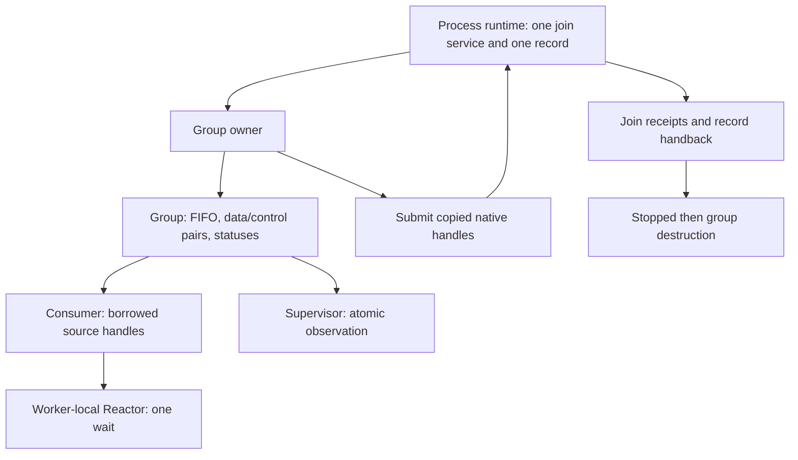

# SG2: Scoped Runtime Ownership

**Исторический контракт первого SG2.** Языковой API уже появился в SG3,
а две активные группы — в B1. Для текущей программы используйте
[scoped-группы](scoped-groups.md); фраза «публичного API пока нет» ниже
относится только к моменту составления этого контракта.

**Статус: контракт внутреннего runtime runner.**

[Первая C-реализация SG2](sg2-runtime-runner.md) проверяет ограниченный runner
и последовательный reuse. Публичного API Liza пока нет; границы приёмки
и отличия тестового accounting от ресурсов ОС перечислены на странице реализации.

[SG0](sg0-lifecycle-contract.md) проверил lifecycle и snapshots,
[SG1](sg1-reactor-worker.md) — композицию с сетевым ожиданием.
[Runtime Reactor](reactor.md) уже умеет
ожидать два заимствованных source sockets. SG2 должен определить их владельца,
бюджет и срок жизни. Он не меняет существующие `channels.run`, `channels.send`,
`channels.receive`, Semantic IR или публичные типы языка.

## Ограниченная первая реализация

Одна новая SG2-группа на процесс одновременно: один producer, один consumer с
worker-local Reactor и один supervisor. Group owner — вызывающий поток.
Группа имеет bounded FIFO `u32`, data wake pair и независимый control wake pair.
Один принятый командный запрос может оставаться необработанным; перенос общего
учёта delivery deadlines на произвольную очередь не подразумевается.

Повторный запуск группы разрешается только после полного освобождения предыдущей.
Вложенное или конкурентное создание получает `Busy` до открытия start gate.
Это ограничение нового внутреннего SG2 runner, не существующего `channels.run`.
Оно позволяет сначала проверить reuse без неограниченного пула join threads.

## Владельцы и заимствования

| Ресурс | Кто владеет | Кто использует | Условие освобождения |
| --- | --- | --- | --- |
| FIFO и protocol mutex | Группа | Producer, consumer | Все участники joined |
| Data wake pair | Группа | Producer signal, consumer reset/wait | Все участники joined |
| Control wake pair | Группа | Owner signal, consumer reset/wait | Owner прекратил signal, все участники joined |
| Status/fault/shutdown records | Группа | Участники, supervisor, owner | Все участники joined |
| Reactor и сетевые соединения | Consumer | Только consumer | Закрываются владельцем до его возврата |
| Native participant handles | Group owner, затем join service | Единственный исполнитель join | Успешный OS join; handle закрыт где требуется |
| Join record и service stack | Process runtime | Owner и service по протоколу передачи | Запись переиспользуется после handback; service живёт до конца процесса |

Числовые descriptors не выдаются producer или Liza-программе. Consumer получает
их только из живого внутреннего group context. Group owner не имеет операции
закрытия отдельного source, пока участники могут им пользоваться. Borrow охватывает
весь интервал исполнения consumer, включая вход в системный wait и возврат из него.
Дескриптор нельзя закрыть и переиспользовать, даже если новый socket получил то же
число. Проверка числа в `poll_sources` не является проверкой времени жизни.

## Запуск и rollback

1. Атомарно резервировать единственное место SG2 и проверить конфигурацию/бюджет.
2. Подготовить process join service, если это первый запуск, и свободную запись.
3. Создать группу, FIFO, protocol synchronization, data/control pairs и statuses.
4. Создать producer, consumer и supervisor с закрытым start gate.
5. Передать service копии handles и открыть start gate лишь после готовности всех
   ресурсов, включая возможность получить реальные join receipts.

При отказе любого шага пользовательские callbacks не запускаются. Уже созданные
участники выходят через отменённый gate; owner получает их реальные join receipts.
Ресурсы без пользователей освобождаются в обратном порядке. Зарезервированное
место возвращается только после полного rollback. Ошибка socket/thread creation
не превращается в `Running` с неполным набором ресурсов.

Отказ создания самого process service возвращает startup failure до запуска
участников. Если service перестал отвечать после передачи handles, применяется
эскалация; owner не выполняет второй join тех же handles и не подделывает receipts.

## Публикация, shutdown и control failure

Сохраняется protocol mutex из SG0/SG1: FIFO inspect, arm, publish, notification
reset и sender close согласованы одним порядком. Admission point — проверка
shutdown/fault под этим mutex. Принятая до shutdown публикация может завершиться
после запроса остановки; consumer закрывает sender под тем же mutex и затем
дочитывает принятые команды. Повторный shutdown не продлевает исходный deadline.

Результаты внутренней отправки остаются `NotPublished`, `Published` и
`PublishedFault`; последняя не разрешает повторить ту же команду как неотправленную.
Sticky notification fault запрещает новые публикации и сохраняет ранее принятые.

Owner публикует shutdown через atomic state и сигнализирует отдельный control
socket, не захватывая protocol mutex. Supervisor наблюдает atomic status/fault,
но не пишет в control socket: у control signal один writer — owner.

Если data notification отказало, owner использует control wake для остановки.
Если control signal тоже не подтверждён, записывается отдельная причина
`ControlWakeFailed`. Это не доказывает, что consumer не проснулся, но отменяет
право рассчитывать на пробуждение. Не выполняются закрытие source из другого
потока, повторное создание socket под прежним номером или скрытый periodic poll.

Owner продолжает наблюдать подтверждения завершения до абсолютного shutdown
deadline. Если все joins получены, cleanup разрешён с сохранением причины отказа.
Если нет — `Unresponsive`, удержание ресурсов и явная process-level эскалация.
Первый runner использует аварийное завершение процесса без обещания деструкторов;
проверки удержания живого worker выполняются с gates в отдельном дочернем процессе.

## Process join service: фиксированная стоимость, безопасный reuse

SG0 создавал отдельный detached service на каждый тестовый процесс. SG2 не должен
копировать это как неограниченный ресурс на каждую группу. Предлагается один
process-lifetime service и одна process-lifetime запись, обслуживающие группы
последовательно. Их стоимость учитывается отдельно от стоимости текущей группы.

Запись проходит `Free -> Submitted -> Joining -> Returned -> Free`. Каждая новая
передача имеет generation; переполнение запрещает дальнейший admission, а не
оборачивает идентификатор. Каждый receipt содержит `(generation, participant_id)`
и результат настоящего OS join; одной generation записи недостаточно. Owner
принимает только receipt текущей generation и созданного участника, ровно один раз.
Старый receipt не может завершить новую группу. Эта проверка дополняет handback,
но не заменяет запрет поздних обращений service к возвращённой записи.

Service получает только native handles и идентификатор записи, без указателей на
FIFO, sockets или group context. Он исполняет системные join для всех созданных
участников, включая supervisor. Supervisor получает stop лишь после завершения
producer/consumer; owner остаётся способен наблюдать его shutdown deadline.

### Точка передачи native handles

Owner заполняет запись эксклюзивно, пока service не имеет права её читать.
Публикация `Submitted(generation)` с release — единственная точка передачи handles.
Service принимает её через acquire. С этого момента только service исполняет
system join и закрывает native thread handles; owner больше никогда не делает
этого самостоятельно, даже если service не подтвердил пробуждение.

Сигнал о новом запросе не является подтверждением передачи владения: его отказ
после `Submitted` не отменяет передачу. Owner проверяет согласованное состояние
записи и generation, а не повторно отправляет те же handles. Неопределённость
наблюдения не разрешает ни повторный join, ни повторный submit. Deadline ведёт
к эскалации с удержанием ресурсов.

До `Submitted` handles принадлежат owner. При частичном startup он отменяет gate
и публикует один rollback-запрос с точным набором уже созданных участников в
заранее зарезервированную запись готового service. Если участников ещё нет,
join-запрос не нужен. Если service отказал и для этого запроса нельзя подтвердить
joins/handback, startup failure не разрешает освобождение живых ресурсов: действует
та же политика deadline и process escalation. Частично заполненная запись никогда
не публикуется как готовая; механизм notify не определяет её committed-состояние.

### Возврат записи

После каждого успешного join service сразу публикует соответствующий receipt
с release: owner может увидеть завершение producer/consumer и запросить остановку
supervisor, не ожидая его join. После последнего join service публикует `Returned`
с release, перестаёт обращаться к содержимому переданной записи и переходит к ожиданию нового
запроса. Owner принимает handback через acquire. Переиспользование разрешено лишь
после этого handback и разрушения предыдущей группы. Все совместно читаемые поля
атомарны либо имеют явный протокол эксклюзивной передачи; одних комментариев о
порядке недостаточно. Service не может отложенно записать что-либо в новую generation.

Это service, а не ещё один watchdog. Если он застрял в join, запись остаётся занятой,
новая группа получает `Busy`; никаких дополнительных service threads не создаётся.
Owner контролирует deadline независимо от join. Process service не называется
joined и не входит в разрешение освобождения группы, поскольку не имеет доступа
к её ресурсам. Его собственная память/стек сохраняются до завершения процесса.

## Бюджет — несколько ограничений, не обещание RSS

Конфигурация до запуска задаёт следующие лимиты и получает отчёт о применённых
значениях. Все арифметические операции размеров проверяются на переполнение.

| Категория | Проверяемое ограничение |
| --- | --- |
| Managed bytes группы | FIFO allocation, group metadata, statuses, mutex/condition storage, журнал при его включении |
| FIFO | Число `u32` slots и размер allocation вместе с внутренними метаданными |
| Участники | Не более трёх native threads: producer, consumer, supervisor |
| Wake sockets | Четыре постоянных socket handles; setup требует ещё одного временного listener, пары создаются последовательно |
| Стеки участников | Явно запрошенный размер на поток, допустимые платформой округления фиксируются в отчёте |
| Process overhead | Один service thread, его запрошенный стек, фиксированная join record и синхронизация |
| Worker-local сеть | Отдельный reactor capacity и его allocation; не включается молча в FIFO budget |

Запрос socket buffer size и запрос stack size не доказывают точный RSS: ОС может
округлять размеры, резервировать адресное пространство, добавлять guard pages и
метаданные. Kernel socket buffers, allocator overhead, TLS и системная стоимость
потоков явно перечисляются как не покрытые managed-byte лимитом. Если платформа
не позволяет соблюсти выбранный лимит, startup отклоняется либо конфигурация
явно задаёт режим только учёта; тихого fallback к неограниченным defaults нет.

Transient setup handles учитываются в high-water mark. Native thread handles и
runtime socket handles считаются отдельно. Возврат admission slot означает, что
перегрупповые allocations и sockets освобождены; process service остаётся ровно
один, а его стоимость не растёт с числом завершённых групп.

### Машинно-читаемый отчёт

Runner возвращает внутреннюю структуру отчёта; тестовый harness сериализует её
в JSON с `schema_version`, `generation`, `phase` и следующими отдельными полями:

- `group_managed_bytes_live`, `group_managed_bytes_peak`, `fifo_allocation_bytes`;
- `group_socket_handles_live`, `group_socket_handles_peak`, `participant_threads_live`;
- `participant_native_handles_live`, `participant_stack_requested_bytes`;
- `process_service_threads`, `process_managed_bytes`, `join_records_in_use`;
- `service_stack_requested_bytes`, `reactor_allocation_bytes`, `reactor_socket_handles_live`;
- `os_overhead_accounting` с явным значением `not_bounded_by_managed_budget`.

Requested stack bytes — конфигурация, не измерение RSS. Live/peak — счётчики
приобретённых runtime ресурсов, а не обещание немедленного возврата страниц ОС.
Отчёт снимается в согласованных точках: до admission, после startup, после
rollback или завершённого destroy. После уничтожения группы её live allocations,
socket/native handles и participant threads равны нулю; `join_records_in_use == 0`
допустимо только после handback и завершённого destroy. Размер FIFO/стеков и peak
сохраняются как сведения о завершённом запуске, а не как live usage.

После первого успешного запуска process service и его память образуют постоянный
baseline. Следующие 100 групп сравниваются с ним: один service, одна выделенная
запись, отсутствие роста managed bytes и занятых handles. Дополнительно harness
сверяет доступные платформенные счётчики handles/descriptors в quiescent-точках,
чтобы проверка не сводилась только к собственным счётчикам runner.

## Критерии приёмки реализации

| Проверка | Требуемое свидетельство |
| --- | --- |
| Нормальный TCP + команда + shutdown | Реальный Reactor, independent control wake, joins до shared destroy |
| Отказ каждого шага создания | Ни одного callback до полного gate; rollback всех уже приобретённых ресурсов |
| Слишком малый бюджет / overflow | Отказ до открытия gate, без утечек и без частичного Running |
| Shutdown внутри wait | Consumer просыпается без periodic timeout; source жив до join |
| Data fault после publish | Команда сохранена, новые отправки отклонены, control path работает |
| Data и control faults вместе | Нет ложного Stopped; дедлайн ведёт к эскалации без shared destroy |
| Worker удержан gate | До его join счётчики shared destroy равны нулю |
| Supervisor или join service не отвечает | Owner не ждёт protocol mutex; admission slot не освобождается |
| Последовательные группы | Не менее 100 create/run/join/destroy; постоянное число process service ресурсов |
| Конкурентный admission | Второй запуск получает Busy и не создаёт участников |
| Отказ notify после Submitted | Owner не выполняет join и не делает повторный submit; ресурсы удержаны до receipts/handback либо эскалации |
| Старая join generation | Receipt отклоняется; новые ресурсы не уничтожаются |
| Service задержан перед handback | Даже все receipts ещё не разрешают reuse записи |

Журнал различает callback exit, настоящий OS join, handback, Stopped и destroy.
Отрицательные мутации должны воспроизводимо обнаруживать закрытие source до
возврата wait, ложный join receipt, преждевременный reuse и пропуск rollback.
Опасные операции перехватываются тестовым guard до фактического use-after-free;
сам timeout внешнего тестового процесса не считается контрпримером.

Платформенная приёмка: Linux/macOS/Windows с настоящим runtime Reactor и
управляемыми точками переключения. Сохранённые snapshots SG0 проверяются отдельно;
счётчики активности не продлевают deadlines. Предполагаются работающие owner,
монотонные часы и механизм остановки процесса. Нельзя обещать ограниченное время
реакции при произвольной остановке самого owner или всего процесса.

## Порядок переноса

Этот документ фиксирует обязательства внутреннего SG2 runner и его
fault-injection tests. После приёмки runner можно определять
Liza-facing API с проверкой ролей и владения. Универсальные worker pools, MPMC,
перезапуск зависших потоков, socket migration и изменения Semantic IR в SG2
не входят.
