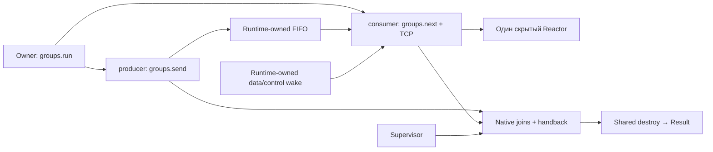

# SG3: scoped Reactor group из Liza

**Описание первого SG3-среза.** Single-group/TCP-only ограничения этой версии
позже расширены UDP в A1 и двумя группами в B1. Актуальное руководство —
[scoped-группы](scoped-groups.md); этот документ сохраняет исходный контракт.

SG3 добавляет экспериментальный библиотечный API `groups.*` поверх
[SG2 runner](sg2-runtime-runner.md). Синтаксис функций, типов и `Result` прежний.
Компилятор назначает две функции entry-модуля — `producer()->u32` и
`consumer()->u32` — нативными callbacks с отдельными полномочиями.

Это ограниченная первая версия: одна активная группа в процессе, bounded FIFO
`u32` с одним необработанным сообщением, один Reactor consumer и один постоянный
join-service. Несколько групп можно запускать последовательно.

## Запуск и результат

```liza
fn producer()->u32:io {
    match groups.send(42) {
        GroupPublication.Published=>{return 0}
        GroupPublication.PublishedFault=>{return 1}
        GroupPublication.NotPublished=>{return 2}
    }
}
fn consumer()->u32:io,alloc {
    match groups.listen(0) {Err(e)=>{return 1} Ok(done)=>{}}
    match groups.next() {
        Err(e)=>{return 2}
        Ok(event)=>{match event {
            GroupEvent.Command(value)=>{if value==42 {return 0}
                return 3
            }
            GroupEvent.Network(count)=>{return 4}
            GroupEvent.Closed=>{return 5}
            GroupEvent.Stopping=>{return 6}
            GroupEvent.NotificationFault=>{return 7}
        }}
    }
}
fn main()->u32:io,alloc {
    config=GroupConfig(65536,65536,1048576,1048576,65536,2,2,5000,1000)
    match groups.run(config) {
        Err(error)=>{return 8}
        Ok(result)=>{return result.producer+result.consumer}
    }
}
```

Поля `GroupConfig` в порядке конструктора:

| Поле | Назначение |
| --- | --- |
| `managed_budget: u64` | Группа и FIFO, без Reactor |
| `process_budget: u64` | Постоянный service и bookkeeping SG2/SG3 |
| `stack_bytes: u64` | Запрошенный стек каждого из трёх участников |
| `service_stack_bytes: u64` | Запрошенный стек постоянного join-service |
| `reactor_budget: u64` | Отдельный бюджет фиксированной allocation Reactor |
| `reactor_capacity: u32` | Вместимость соединений Reactor, 1–32 |
| `slots: u32` | Вместимость FIFO; SG3 сохраняет ограничение одного in-flight значения |
| `operation_ms: u32` | Срок отдельного обязательства |
| `shutdown_ms: u32` | Срок остановки, установленный один раз |

Запрашиваемые стеки кратны 64 КиБ. Service stack фиксируется первым успешным
запуском; следующий запуск с другим размером отклоняется. Пределы трёх участников
и пяти временных wake handles задаёт адаптер. Kernel buffers, TLS, allocator
metadata и фактический RSS не ограничиваются `managed_budget`.

`groups.run` возвращает `Result<GroupRun,GroupError>`. `GroupRun` содержит
`producer`, `consumer`, `fault`, `control_fault` (`u32`). Ненулевые результаты
callbacks сами по себе не превращаются в ошибку запуска.

| Исход | Что известно |
| --- | --- |
| `Ok(GroupRun)` | Все участники joined, handback получен, общие ресурсы уничтожены |
| `InvalidConfig` | Конфигурация отклонена |
| `Busy` | В процессе уже выполняется группа |
| `StartupFailed` | Callbacks не запускались; частичный startup безопасно свёрнут |
| `Faulted(GroupRun)` | Известный fault; результаты возвращаются после joins и cleanup |
| Process abort | Возвращаемого `Result` нет, cleanup не обещается |

Коды `fault` соответствуют SG2: 0 — отсутствует, 1 — data wake, 2 — control wake,
3 — нарушено обязательство участника/доставки, 4 — supervisor не отвечает,
5 — ошибка закрытия Reactor. `control_fault` отдельно сохраняет отказ отправки
control wake. У истёкшего shutdown deadline исход `_Exit(86)`; это не `Err`.
Trap в callback также не обещает возврата результата или раскрутки ресурсов.

## Роли и владение



`groups.listen(port)` создаёт loopback listener и регистрирует Reactor. Только
consumer может вызвать его; повторное создание отклоняется. У языка нет значения
этого Reactor, wake descriptor, protocol mutex или native thread handle. После
возврата consumer callback wrapper закрывает Reactor в том же потоке, до join.

Consumer использует `groups.port`, `accept`, `connect`, `finish_connect`, `interest`,
`ready`, `disconnect`, `stop_accepting`, `write` и `read`. Их результаты и правила
range/buffer совпадают с [Reactor API](reactor.md); аргумент Reactor отсутствует.
`connect` в SG3 пока loopback-only. `net.Connection` — непрозрачный проверяемый ID,
не сокет и не передача владения. Через FIFO передаётся только `u32`.

`groups.read(id, move buffer, start, count)` возвращает буфер и
`Result<u32,ReactorError>`. Semantic IR сохраняет storage origin входного буфера;
существующие проверки lifetime, readonly views и закрытия Region продолжают
действовать. Обходных операций `groups.close` или `groups.sources` нет.

## Ожидание, закрытие и остановка

`groups.next()` сначала проверяет FIFO по протоколу SG2, затем ждёт сеть и оба
управляющих источника одним `poll(-1)` / `WSAPoll(-1)`. Периодического timeout
для consumer нет. Ошибка ожидания возвращается как `Err(ReactorError)`.

| Событие | Семантика |
| --- | --- |
| `Command(value)` | Значение извлечено из FIFO; началось обязательство обработки |
| `Network(count)` | Готовы сетевые источники, без data/control wake в счётчике |
| `Closed` | Producer закрыл sender; выдаётся один раз после чтения очереди |
| `Stopping` | Owner запросил остановку; принятые значения сначала доступны для чтения |
| `NotificationFault` | Протокол обнаружил fault, а очередь уже проверена |

После `Closed` consumer может продолжить обслуживание своих соединений через
`groups.next()`. Политику завершения сетевой работы выбирает приложение. Само
закрытие sender не заменяет shutdown и не разрешает destroy. Если callback
возвращается раньше чтения всей очереди, SG3 не обещает обработку оставшихся команд.

При наблюдаемом shutdown политика приоритета явная: сначала доступна уже принятая
команда, затем выдаётся `Stopping`. Даже если одновременно готовы TCP, data wake
и control wake, отдельное событие `Network` перед `Stopping` не гарантируется.
Readiness не означает, что сетевой I/O уже выполнен; приложение само определяет,
нужно ли завершить ограниченную сетевую работу перед возвратом callback.

После однократного `Closed` отсутствие сети и команд допускает неограниченный
Idle consumer в `poll(-1)`; завершившийся producer этого не меняет. Когда оба
callbacks вернулись, owner начинает остановку, завершает supervisor и получает
все join receipts/handback перед возвратом `groups.run`.

`groups.send` возвращает `Published`, `PublishedFault` или `NotPublished`.
`PublishedFault` никогда не разрешает повторить публикацию как будто её не было.
`NotPublished` включает занятое delivery obligation, закрытие и sticky fault;
автоматической блокирующей повторной отправки в SG3 нет.

Обе роли могут вызвать `groups.stop()` (асинхронный запрос), `groups.stopping()`
(0/1) и `groups.busy()` (явное начало нового обязательства). `busy` нельзя трактовать
как heartbeat для бесконечного продления прежней задачи. Producer при входе в
callback имеет ограниченное обязательство; неограниченное ожидание без нового
контракта работы ему не предоставляется.

Consumer становится Idle только после согласованной проверки FIFO. Delivery
obligation контролируется независимо. После сетевого события он снова Busy.
У группы в Running нет общего ограничения времени. Если роль наблюдает
`stopping()==1`, соответствующий ненулевой shutdown deadline уже опубликован.
Owner/supervisor по-прежнему используют интервалы наблюдения SG2 в 1 мс: отсутствие
polling относится к сетевому consumer, а не ко всему процессу.

## Проверки компилятора и приёмка

Semantic IR содержит `group_contract` версии 1: назначенные entries, роли
достижимых функций, владельцев Reactor/notification, условия возврата и эскалации.
Полный граф вызовов проверяется после generic specialization. Producer не получает
сетевые полномочия consumer; owner не может вызвать роль через helper; callbacks
нельзя вызывать как обычные функции. Смешивание `groups.run` с `channels.run` или
`workers.run` пока запрещено. Process-signal watcher и произвольный внешний I/O
из callbacks не входят в разрешённые операции.

Исполняемый пример:

```sh
python -m liza run examples/workers/reactor_group.liza
python -m unittest discover -s tests -p test_sg3.py -v
```

Пример передаёт команду и выполняет настоящий loopback TCP write/read. Тесты
проверяют `-O0`/`-O2`, последовательный reuse, результаты обеих ролей, бюджеты,
отрицательные случаи ролей через imported generic helper, startup failure без
callbacks, сохранение команды после notification fault и process abort без
возвращаемого результата при двойном wake fault. Отдельный стенд удерживает
consumer в одном системном ожидании не менее 750 мс до запроса остановки.
Общий pure helper разрешён обеим ролям; общий helper с публикацией или сетевым
I/O отклоняется. Отдельный сценарий удерживает consumer в Idle после `Closed`
дольше `operation_ms`, затем запрашивает shutdown и проверяет однократность
`Closed` и успешное завершение.

Конкурентная отрицательная мутация публикует `shutdown` раньше deadline и
управляемо удерживает это окно: независимый наблюдатель отклоняет состояние
`shutdown=true, deadline=0`. Это проверка конкретных исполнений, не доказательство
всех расписаний C/ОС. Автоматическое восстановление после trap, параллельные группы,
универсальные callbacks и многопоточный RTP fanout остаются вне SG3.

UDP extension: [SG4-A1](sg4-a1-udp.md).


Продолжение модели — [SG4-B1](sg4-b1-multiple-groups.md): две активные группы,
отдельные join lanes и `groups.run_pair` с четырьмя статическими callbacks.
Указанные выше ограничения первого SG3-среза описывают исторический baseline.

Исторический [аудит SG4-A](sg4-a-udp-baseline.md) сохранён отдельно; текущий пользовательский вход описан в [руководстве scoped-групп](scoped-groups.md).
