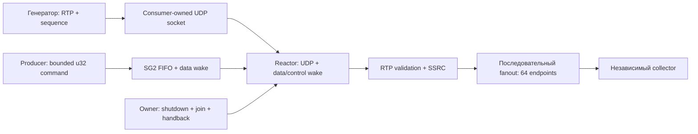

# SG4-A: аудит UDP fanout и контракт измерений

Статус: **исторический аудит; SG4 завершён**. Документ сохраняет исходный
план до UDP-интеграции. Формулировки «сейчас», «нужно» и ограничения SG3 ниже
относятся к снимку аудита, а не к текущему runtime.

Результаты этапа: [UDP API](sg4-a1-udp.md), [Liza/C baseline](sg4-a2-rtp-fanout.md),
[latency follow-up](sg4-a2-latency.md), [проверка collector](sg4-a2-collector.md),
[две активные группы](sg4-b1-multiple-groups.md) и [dual RTP workload](sg4-b2-dual-owners.md).
Для написания программы используйте [текущий scoped API](scoped-groups.md).
Аудит выполнен по `6ba7d07` (SG2 и SG3 в main). Цель — измерить один сетевой
consumer на полезной нагрузке, прежде чем выбирать архитектуру SG4-B.
Этот документ не содержит новых результатов производительности.

## Что уже можно использовать

| Исходник | Реализовано | Ограничение для SG4-A |
| --- | --- | --- |
| `examples/apps/rtp_fanout.liza` | Один UDP socket, 2048-байтовый буфер в Region, RTP validation, SSRC filter, до 64 получателей, счётчики | Блокирующий receive, loopback, CLI/console и ручной cleanup; нет groups |
| `examples/apps/rtp/packet.liza` | RTP v2, CSRC, extension length, padding | Парсер заголовка, не полный RTP/RTCP stack |
| `examples/apps/rtp/receivers.liza` | Фиксированные 64 slots, add/learn/remove, IPv4 endpoint | Локальная таблица; приложение пока задаёт loopback destinations |
| `benchmarks/udp-fanout/fanout.c` | Последовательный C-эталон с эквивалентным разбором RTP | POSIX; текущий lifecycle не эквивалентен SG2 |
| `benchmarks/udp-fanout/nb1c.py`, `nb1c_collector.c` | Раздельные процессы, нативный сборщик, unique delivery, CPU/RSS, гистограмма задержки | Один хост, три повтора в сохранённом отчёте, ограниченный drain |
| `benchmarks/udp-fanout/nb1b_build.py`, `controlled_runtime.c` | Управление фазой/drain/stop через отдельный pipe | Переписывают исходник и переопределяют Interrupted/WouldBlock; не production API |
| `benchmarks/rtp-fanout/` | Синтетический pthread probe 0/1/2/4/8 workers | Не RTP: общий socket, общий buffer и barrier на каждый пакет; не основа SG4-A |

[Существующие измерения](network-performance.md) остаются историческими NB1-C
результатами. Их нельзя переименовать в SG4-A или использовать как измерение
нового группового runtime. Тесты `tests/test_rtp_fanout.py` и
`tests/test_rtp_receivers.py` дают исходный функциональный corpus для переноса.

## Разрыв между RTP-примером и SG3

[SG3](sg3-scoped-reactor-group.md) создаёт скрытый TCP Reactor через
`groups.listen`. В `liza/runtime/reactor_common.h` wait set включает listener,
TCP slots и максимум два заимствованных источника. Оба источника уже заняты
SG2 data/control wake. UDP нельзя незаметно добавить третьим wake descriptor.

`liza/runtime/net_common.h` уже содержит IPv4 UDP bind/send/receive и обнаружение
truncation (POSIX и Windows), но отдельный UDP handle не зарегистрирован в Reactor.
Прямой перенос `net.udp_*` в callback отклонит аудит ролей `liza/ir.py`.
Нужны неблокирующий режим и сохранение buffer origin при чтении, а не обход аудита.

Есть ещё два ограничения, которые нельзя скрыть за новым UDP builtin:

- Callbacks `producer()` / `consumer()` не принимают конфигурацию. CLI и console
  не входят в их разрешённые внешние операции. Нельзя просто перенести setup и
  печать счётчиков из старого `main` внутрь consumer.
- Producer имеет конечное обязательство и не имеет блокирующей операции ожидания
  управления. `groups.busy()` не заменяет ожидание и не разрешает вечный heartbeat.
  Один in-flight `u32` не подходит для передачи RTP payload или всей таблицы.

## Минимальная реализация после аудита

Предлагается один скрытый consumer-owned UDP endpoint, используемый и для receive,
и для последовательного sendto. Reactor должен уметь создаваться без TCP listener;
UDP становится его собственным сетевым источником. Два заимствованных wake sources
сохраняют прежние обязанности. В SG4-A не требуется несколько UDP sockets,
смешанная TCP/UDP конфигурация или передача сокетов между потоками.

Предлагаемые операции `groups.udp_bind`, `udp_port`, `udp_receive`, `udp_send`
пока **не существуют**. Они consumer-only, не возвращают raw socket и не дают
операции независимого close. Receive возвращает перемещённый buffer и результат
с длиной/адресом; Semantic IR сохраняет storage origin. Readiness не гарантирует
успех следующего receive: WouldBlock допустим. Truncated datagram считается
полученным и отброшенным целиком; частичный пакет не рассылается.

В первом slice consumer обрабатывает не более одного datagram и его 64 отправок
между обращениями к `groups.next()`. Это ограничивает задержку команд и shutdown
при непрерывной сети; drain-until-empty без лимита запрещён. Сам лимит в 64 sendto
не гарантирует ограниченного wall-clock времени. Измеряются длительность
fanout-цикла (p50/p95/p99/max), максимальный интервал между проверками control/shutdown
и задержка от публикации команды до её обработки (включая p99).
Для shutdown отдельно фиксируются request, наблюдение consumer и завершение join.
Большая задержка требует сначала исследовать цикл, а не добавлять workers.
Инструментирование и его overhead одинаковы для Liza/C. UDP socket закрывает
consumer wrapper до выхода потока. Общие wake/FIFO уничтожаются после joins и
handback. В budget/report добавляются UDP handle и фиксированное состояние;
kernel socket buffers учитываются отдельно от managed bytes.

Для первого воспроизводимого workload конфигурация endpoints/SSRC и параметры
серии могут быть сгенерированы как **ограниченные константы приложения**; один
бинарник на конфигурацию, не на отдельный повтор. Все повторы одной конфигурации
используют один бинарник; SHA-256 generated source и бинарника сохраняются
в manifest. Пересборка между повторами запрещена.
Это позволяет проверить произвольный IPv4 адрес без нового механизма capture.
Producer публикует одну заранее заданную управляющую команду и возвращается;
consumer продолжает после Closed. Динамическая загрузка таблицы и длительный
управляющий producer не входят в этот baseline.

До реализации нужно зафиксировать узкий путь управления фазами и выгрузки
счётчиков: benchmark harness может наблюдать bounded counters и инициировать
штатный SG2 stop, но не подменять UDP receive/send, не кодировать команды в
ошибках I/O и не закрывать descriptor из чужого потока. Такой adapter должен быть
явно выделен и одинаково учтён в Liza/C. Нельзя объявлять этот вариант полностью
самостоятельным Liza-сервисом с публичным control API. Отдельная функциональная
проверка должна показать реальную доставку `groups.send` при UDP readiness.

## Равенство сравниваемой работы

Основное сравнение: приложение Liza и C callback над тем же SG2 lifecycle и
Reactor UDP backend, с одинаковыми budget, supervisor, wake policy, validation,
64 endpoints, одним входным буфером 2048 байта и последовательными sendto.
Это изолирует прикладной код/генерацию кода, но не сравнивает два независимых runtime.
Существующий standalone POSIX C допустим дополнительной строкой с явной пометкой
о различии lifecycle и накладных расходах. Не смешивать эти строки.

Никаких sendmmsg, payload queue, packet pool, retry queue или batching только
для одной реализации. Для нагрузочных серий ошибка отдельного send учитывается,
отправки остальным получателям продолжаются; автоматического retry нет.
Фатальная ошибка receive/wait завершает серию как failed с причиной. Interrupted
обрабатывается одинаково и не означает команду управления.

## NB1 профиль и фазы

| Параметр | SG4-A |
| --- | --- |
| RTP | Ровно 1200 байт: 12-byte header + 1188-byte payload |
| Поля | V=2, PT=96, SSRC=0x10203040; RTP sequence = ordinal modulo 65536 |
| Идентификация | Полный u32 ordinal в первых 4 байтах payload, как в NB1; длина серии ограничена до его wrap |
| Получатели | 64 отдельных UDP endpoints, фиксированных на измеряемую фазу |
| Частоты | 2000 / 5000 / 10000 входных datagrams/s |
| Серии | 5 секунд измеряемой подачи, минимум 5 повторов каждой пары implementation/rate |
| Длинная серия | После короткой приёмки: 60 секунд, минимум 5 повторов; отдельно в отчёте |
| Платформы | Linux и macOS — измерения; Windows — функциональная приёмка |
| Топология | Loopback как диагностика; отдельные generator/service/collector hosts для выводов о физической сети |

Использовать корпус NB1 и отдельные malformed/truncated/wrong-SSRC проверки.
В длительных сериях collector обязан использовать полный ordinal, а не только
16-bit RTP sequence. Каждый запуск имеет отдельную идентичность в артефактах;
старые datagrams не должны попадать в следующий запуск.

Readiness acknowledgement публикуется только после успешного создания и bind UDP
endpoint, его включения в wait set и готовности consumer обслуживать вход.
Запуск процесса сам по себе не является Ready. Warmup начинается только после
этого подтверждения; startup failure завершает серию без измерения throughput.

Фазы: setup → readiness acknowledgement → warmup в тех же процессах → подтверждённый
reset счётчиков/новый диапазон sequence → 5 s подачи → 0.5 s fanout drain →
штатный stop/join → 1 s collector drain → отчёт. Записывать реальные timestamps
всех границ, включая момент наблюдения команды consumer. Drain — отдельная фаза,
а не дополнительные секунды знаменателя offered rate. Очереди, оставшиеся после
collector drain, входят в ненаблюдаемую доставку; это не доказательство wire loss.
Порядок Liza/C чередовать или рандомизировать с сохранённым seed; показывать все
повторы, а не только лучший. Генератор сохраняет фактический pacing и send errors.

## Счётчики и задержка

Обозначения относятся к одному диапазону sequence, включая его bounded drain:

| Счётчик | Источник |
| --- | --- |
| offered / input_sent | Генератор: запланировано / ОС приняла send |
| received / received_unique | Приложение: datagrams / уникальные входные ordinal |
| valid, invalid, wrong_ssrc, truncated | Взаимоисключающие результаты классификации received |
| attempted, succeeded, failed | Приложение: исходящие вызовы send и их исходы |
| delivered_unique | Collector: уникальные пары (receiver, ordinal), проверенные байты |
| duplicate, reordered, corrupt, unexpected | Collector, отдельно от delivered_unique |

Для валидной серии без изменения таблицы: `attempted = valid * 64` и
`attempted = succeeded + failed`. Нарушение равенств — ошибка учёта/реализации,
не сетевой loss. В серии с прерыванием fanout учитывать skipped sends отдельно.

`input_sent - received_unique` — входной недоприём к концу drain, не обязательно
потеря в сети. `invalid + wrong_ssrc + truncated` — прикладной discard.
`failed` — локальный отказ отправки. `succeeded - delivered_unique` — агрегатная
разница локально принятых отправок и наблюдений, а не доказательство причины.
Если требуется точная атрибуция, сопоставлять пары receiver/ordinal и исход send;
не выводить её из одних агрегатов. Host-wide UDP counters — дополнительный сигнал,
не счётчик конкретного socket.

Публиковать p50/p95/p99 только вместе с delivered coverage: относительно
`input_sent * 64` и отдельно относительно successful sends. Сохранять per-receiver
coverage, duplicates/reordering и общий результат. Нельзя отбрасывать перегруженные
серии ради красивых percentile. Гистограмма имеет фиксированные границы, overflow
bucket и sample count; percentile — верхняя граница bucket, не точное значение.

На loopback latency считается по общему monotonic clock. Между машинами нельзя
вычитать несогласованные monotonic timestamps: необходимы измеренная синхронизация
часов и её погрешность, либо latency помечается unavailable. RTT-эксперимент
не переименовывается в one-way delivery latency.

## Отчёт и поиск ограничения

Один machine-readable manifest и читаемый отчёт должны содержать:

- Commit, source/generated-source/binary hashes, все build commands, Liza/LLVM/Clang,
  optimization, target, ОС/CPU/NIC, topology/MTU и реальные socket buffer sizes.
- Параметры фаз и repeats, raw counters/histograms, seed/order, фактический pacing,
  причины завершения, ошибки harness, invalid/failed runs без сокрытия.
- Process user/system CPU и CPU consumer/producer/supervisor/service, если платформа
  позволяет; unavailable явно. Отдельно CPU generator/collector, idle и load.
- RSS с указанием peak или sampled, managed budgets, handles/stacks и process-lifetime
  join-service. Supervisor overhead не приписывать только consumer.
- Throughput received и delivered; знаменатель/интервал явно, steady-state и drain
  отдельно. Никаких утверждений о скорости физической сети из loopback.

Объяснение bottleneck требует evidence: например, CPU profile/syscall counts,
достигнутая частота генератора, загрузка collector, UDP drops и buffer sensitivity.
Профилирование — отдельный прогон, его overhead не смешивается с основной серией.
Bounds checks, buffer copies и runtime calls проверяются по emitted IR/assembly и
профилю, а не объявляются причиной заранее. Если данных недостаточно, итог —
«ограничение не локализовано» с конкретным следующим экспериментом.

Стоимость разработки сравнивать отдельно: прикладные nonblank/noncomment LOC
по опубликованному списку файлов; parser/table, harness и runtime — отдельные
категории. Перечислить ручные cleanup ветви и воспроизводимые compile-reject
примеры (неверная роль UDP, утечка buffer lifetime, доступ через общий helper).
Меньше строк или ветвей само по себе не является доказательством безопасности.

## Приёмка реализации и граница следующего PR

Функциональные gates: UDP + команда одновременно; Idle без периодического poll;
shutdown из poll; sustained UDP не вытесняет команду; truncation/invalid RTP;
ошибки send/notification; сохранённая публикация после fault; close только
в consumer; joins/handback до shared destroy; compile-reject ролей и lifetime.
На Windows проверяются те же ownership и datagram semantics, а не performance threshold.

Audit PR завершён этим контрактом и навигацией. Реализация разделена на два PR:

| Этап | Изменение | Приёмка |
| --- | --- | --- |
| SG4-A1 | Consumer-owned UDP endpoint в Reactor/SG3, consumer-only API и buffer origin | Linux/macOS/Windows: ownership, truncation, readiness, команды и shutdown; без benchmark features |
| SG4-A2 | RTP fanout Liza/C, ограниченный harness, generated config и отчёт | Counters, latency, CPU/RSS, fanout/control timing, одинаковые бинарники повторов и lifecycle |

A2 использует проверенную семантику A1. Если измерения выявят ошибку runtime,
исправление и регрессионная проверка должны быть явно выделены, а не скрыты
в изменении benchmark. Отсутствующие Linux/macOS измерения нельзя заменять CI
smoke-test или выдуманными данными. SG4-B (1/2/4/8 владельцев, dispatcher,
payload transfer и backpressure) остаётся без выбранной архитектуры до SG4-A.
