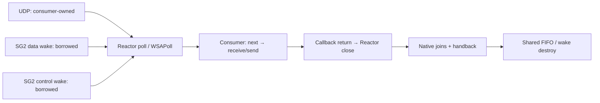

# SG4-A1: UDP endpoint scoped-группы

SG4-A1 расширяет [SG3](sg3-scoped-reactor-group.md) одним неблокирующим IPv4 UDP
endpoint, которым владеет сетевой consumer. Это первая часть SG4-A: RTP fanout,
benchmark harness и измерения относятся к отдельному A2.

## API и владение

| Операция | Результат |
| --- | --- |
| `groups.udp_bind(address: net.Address)` | `Result<u32, ReactorError>`; создаёт скрытый Reactor с одним UDP socket |
| `groups.udp_port()` | `Result<u16, UdpError>`; фактически назначенный порт, включая bind на порт 0 |
| `groups.udp_receive(move buffer)` | Буфер и `Result<u64, UdpError>` с длиной и адресом отправителя |
| `groups.udp_send(data, start, count, address)` | `Result<u32, UdpError>`; одна отправка диапазона View |

Bind использует `ReactorError`, поскольку включает выделение Reactor и проверку
его параметров; I/O использует существующий `UdpError`. Адрес задаётся через
`net.ipv4`; bind не ограничен loopback. DNS, multicast membership и IPv6 не добавлены.

Все четыре операции доступны только consumer. Это проверяется по достижимым
вызовам, в том числе через helper/generic; общий helper обязан удовлетворять
полномочиям каждого вызывающего участника. У программы нет UDP handle или операции
независимого close. `udp_bind` и `listen` взаимно исключаются: повторное создание
возвращает ошибку. TCP connect в UDP Reactor также отклоняется.

После неуспешного bind создание можно повторить: частичный socket/Reactоr освобождён.
После успешного bind `udp_port`, send/receive и `groups.next` используют этот endpoint.
Как и в SG3, сетевые операции требуют предварительно созданного Reactor;
вызов до успешного создания нарушает runtime-контракт.



UDP socket является собственным сетевым источником Reactor. Два заимствованных
источника остаются data/control wake; третьего borrowed source нет. TCP listener
при UDP bind не создаётся. Socket закрывается consumer wrapper после возврата
callback, до подтверждения его join. SG2 освобождает общие ресурсы после joins
и handback. При process abort cleanup по-прежнему не гарантируется.

Фиксированное UDP-состояние входит в `sizeof(reactor)` и проверяемый `reactor_budget`;
SG2 report отражает allocation через `reactor_allocation_bytes`. UDP-only Reactor
имеет максимум один собственный socket, отдельно от wake handles группы.
Новых потоков или process-lifetime allocations нет. Kernel socket buffers и RSS
не входят в managed budget. `reactor_capacity` сохраняет существующие пределы
конфигурации 1–32, но не означает поддержку нескольких UDP endpoints.

## Datagrams и ожидание

`groups.next()` ждёт UDP вместе с командами и shutdown одним системным ожиданием.
Готовность UDP возвращается как `GroupEvent.Network`; счётчик не включает wake
sources и не означает число datagrams. После readiness чтение может вернуть
`WouldBlock`. При ошибке readiness приложение выполняет I/O и получает его исход;
само событие не гарантирует успешного receive.

Receive возвращает тот же buffer на всех исходах; Semantic IR сохраняет Region
origin. Метаданные декодируются существующими `net.udp_length`, `udp_source_ip`,
`udp_source_port`. Нулевой datagram — успешное чтение длины 0, не EOF.
Слишком большой datagram потребляется целиком и возвращает `Truncated`;
содержимое буфера после ошибки не должно обрабатываться как полный пакет.

Send не копирует payload в дополнительную runtime-очередь и не повторяет отправку.
`WouldBlock` и прочие ошибки возвращаются вызывающему; успех означает приём
локальной ОС, а не доставку получателю. Проверяются диапазон View, порт и предел
длины datagram. Socket неблокирующий для receive и send.

Политика SG3 сохраняется: принятая команда проверяется перед остановкой, `Closed`
выдаётся один раз и не закрывает сеть. Consumer может законно оставаться Idle
после завершения producer. Shutdown будит его через отдельный control wake.
Приложение должно регулярно возвращаться к `groups.next()`; A1 не прерывает
произвольный прикладной цикл. Для fanout A2 установлен один пакет/64 отправки
между проверками control с измерением длительности этого цикла.

## Проверки

[Пример UDP группы](https://github.com/rulerom/liza/blob/main/examples/workers/udp_group.liza)
публикует команду 42 и выполняет UDP roundtrip через собственный endpoint без
передачи raw descriptor. Это функциональная проверка, не benchmark.

```sh
python -m liza run examples/workers/udp_group.liza
python -m unittest discover -s tests -p test_sg4_udp.py -v
```

Приёмка включает O0/O2, неправильные роли, общий helper и сохранение buffer lifetime.
Нативный стенд проверяет ошибку bind с последующим повтором, WouldBlock, truncation,
пустой datagram, команду вместе с UDP, shutdown при непрерывном UDP, один idle wait
не менее 750 мс и сохранение публикации при data-wake fault. Журнал lifecycle
требует Reactor close до consumer join и все joins/handback до shared destroy;
после завершения проверяется повторный bind того же порта.

Платформенная матрица Linux/macOS/Windows запускается в workflow SG3 вместе с
прежними TCP-проверками. Эти сценарии проверяют выбранные исполнения и ownership;
они не доказывают все расписания ОС, производительность или bounded wall-clock
длительность sendto. Настоящий RTP workload и Liza/C отчёт будут в SG4-A2.
