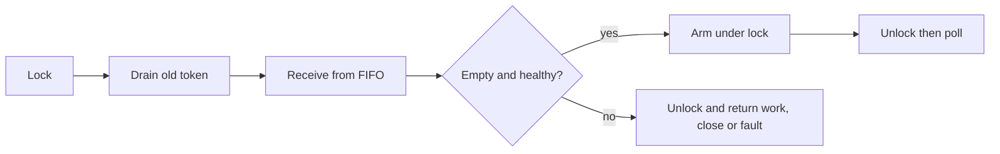

# Serialized notification protocol — experimental C slice

One outer mutex serializes every FIFO operation and notification state change.
The existing FIFO retains its internal lock; lock order is always wrapper then
FIFO. Direct FIFO access is forbidden. There is one consumer. Before every
sleep it calls `take_or_arm`: drain the outstanding token, inspect FIFO, and
arm only if empty and healthy, all under the wrapper lock. A producer publishing
after arming writes a token before releasing that lock. While consumer is
running, publication needs no token: the consumer must check again before sleep.
Sender close uses the same lock and notification rule. No new syntax or public
Liza channel API is introduced.

`NOT_PUBLISHED` means no new value entered FIFO (Full, Closed, or sticky fault).
For this private interface sticky fault is rejected with the closed reason;
`protocol_fault` distinguishes it. `PUBLISHED` means publication completed and
either the consumer is running, an existing token covers the wake, or a token
write succeeded. It does not guarantee processing. `PUBLISHED_FAULT` preserves
the publication but records failed notification. Fault is sticky; new sends
are rejected. A consumer can still read already published values with the
fault flag set, but must not sleep on that result.

The wrapper itself and its fixed socket pair are additional user/OS resources
beyond the FIFO's 1024-byte allocation budget. All protocol memory is fixed
after initialization. Kernel buffers and thread stacks are not included.
Writes/reads are nonblocking, but mutex acquisition has no bounded latency.
All wake errors, including WouldBlock, are faults. Socket/thread portability
helpers are reused from the previous probe, not added to production runtime.

Tests cover armed publication, two queued values behind a notification, Full,
injected signal failure preserving data, sticky rejection, sender close racing
publication, and destruction after joining the publishing thread. Three runs
each exercise 100 close races; this is not exhaustive scheduling. They do not
measure idle CPU or prove model refinement. Consumer-close/discard races,
mutation validation, and reactor integration remain separate work.

## Supervisor boundary

`protocol_fault` exposes state independently of the data wake socket, but no
supervisor loop or reliable fault delivery is implemented here. A stopped
producer/supervisor or a permanently held mutex may prevent observation.
No watchdog or process-abort guarantee is claimed. A future group must define
fault observation, controlled termination and detection of supervisor failure
before adopting this protocol; merely exposing a flag is insufficient.
Destruction requires the owner to join **all** users first, including any future
supervisor. The prototype does not autonomously enforce that lifetime rule.

Run: `python3 -m unittest discover -s experiments/notification_protocol -v`.
